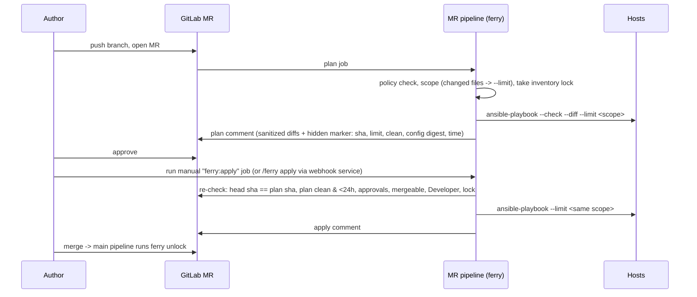

# ferry

Atlantis-style plan/apply for Ansible. An MR gets a check-mode plan (with diffs) as a comment; an
approved MR whose plan is current can be applied; a scheduled drift run reports hosts that no
longer match the default branch. GitLab CI is the first driver; the engine is written so a webhook
service can drive it without changes. GitLab and GitHub backends are included (`--vcs`).

```
ferry plan      # MR pipeline: check --diff on the hosts the MR affects, comment the plan, take the lock
ferry apply     # MR pipeline, manual job: apply if every gate passes, comment the result
ferry drift     # default branch, scheduled: check mode on every host, metrics for Prometheus
ferry unlock    # default branch, after merge: release the merged MR's lock
ferry scope F.. # which hosts/groups a set of changed files maps to
ferry policy    # static checks (no check_mode: false outside allow-list, no pipe lookups, no reboot)
```

## How a change flows



## Gates on apply

All re-checked inside the apply job, against live GitLab state:

- The pipeline's commit is the MR head, and the newest plan (posted by ferry's own account; markers
  from anyone else are ignored) is for that commit, is clean (no failed/unreachable/blocked host),
  is younger than `apply.max_plan_age_hours`, and was made with the same `ferry.yaml`.
- Re-computed scope equals the planned scope.
- MR open, not draft, no conflicts, blocking discussions resolved, not otherwise unmergeable
  (`ci_still_running` is fine: the apply job runs in that pipeline).
- `apply.min_approvals` approvals (the author's own doesn't count unless `allow_author_approval`). Only approvals from users who could apply themselves count (write on GitHub, Developer+ on GitLab), and ferry's own account never does: on a public GitHub repo anyone can leave an approving review.
- The person running it has Developer+ (or is in `apply.allowed_users`).
- **GitHub: the code host's own rules would allow the merge**, on top of ferry's approval check
  (both must pass). See [GitHub branch protection and rulesets](#github-branch-protection-and-rulesets).
- The MR holds the inventory lock (or the lock is free / its holder MR is closed or merged).

## Locks

One lock per inventory, taken at plan time and held until the MR merges or closes (Atlantis
semantics), so two MRs can't interleave plans and applies on the same hosts. A service keeps them in
its own file (`SQLiteLocks`, `FERRY_LOCK_DB`; Atlantis uses a BoltDB file the same way). CI-only
GitLab driver, which has no storage of its own: an
annotated tag `ferry-lock-<inventory>` (creation is atomic server-side; the message holds the holder).
A lock whose MR is no longer open is stale and taken over automatically. Exclude
`ferry-lock-*` tags from pipelines in the consumer's `workflow:rules`. Use a CI `resource_group`
on apply jobs as a second guard.

## Busy hosts

A failed task whose message starts with `guard.busy_marker` (`FERRY_HOST_BUSY` by default) means
"this host refused to be touched" (e.g. a 3D printer mid-print). ferry shows the host as
**blocked**, not failed: a plan with a blocked host isn't clean (so it can't be applied), an apply
that meets a newly busy host leaves that host alone and reports it blocked while the other hosts
proceed, and drift doesn't write to that host.

## Drift

`ferry drift` runs check mode over the whole inventory at the default branch, then writes
`ansible_drift.prom` into each reachable, non-blocked host's node_exporter textfile directory
(ferry's `drift_report.yml`, which runs `drift.report_pre_role` first, so busy hosts stay
untouched). That is ferry's only write during a drift run. Unreachable/blocked hosts keep their old
file, which goes stale and alerts. It also writes `drift.json` / `drift.prom` locally (CI artifacts).

| metric | meaning |
|---|---|
| `ansible_drift_last_run_timestamp_seconds` | last finished drift check on this host |
| `ansible_drift_changed_tasks` | tasks check mode says would change (0 = matches main) |
| `ansible_drift_failed_tasks` | tasks that failed during the check (the check is broken) |
| `ansible_drift_info{commit}` | commit compared against |

Policy is alert, don't remediate. Auto-remediation would be `ferry apply`-like run of main on
drifted hosts; deliberately not implemented.

## Output safety

Plan/apply comments only contain what passes `ferry.sanitize.Redactor`: no_log results (Ansible
censors them before callbacks; ferry also drops their diff/msg), diffs of sensitive paths
(shadow, keys) suppressed, values of credential-looking env vars masked, and regexes for PEM keys,
Vault/GitLab/Slack/AWS tokens, crypt hashes and `password=...`. The contract is still: put `no_log`
on any task that handles a secret.

## Threat model (read before reusing at work)

A plan runs the MR's code with the inventory's SSH credentials. Check mode limits what tasks do,
but `check_mode: false`, controller-side lookups and custom plugins all run for real. `ferry policy`
catches the obvious ones; it is not a sandbox. In CI-only mode, anyone who can push a branch can
change `.gitlab-ci.yml` too, so the credential is only as safe as push access. That's acceptable for
a single-owner homelab. For a team, run ferry as a service (the webhook driver) that holds the
credential itself, takes `ferry.yaml`/CI config from the default branch rather than the MR, and
requires approval before planning MRs from untrusted authors.

## Running as a service (GitHub App)

`ferry serve` is the Atlantis-style deployment: a long-running service with a GitHub App, holding
its own credentials, so nothing in a PR can change how ferry runs.

```mermaid
sequenceDiagram
  participant GH as GitHub
  participant S as ferry serve
  participant B as OpenBao
  participant H as Hosts
  GH->>S: webhook (signed): PR opened / synchronize, or "/ferry plan|apply"
  S->>S: verify HMAC, dedupe, plan rule, queue (one job at a time)
  S->>GH: fetch default branch (ferry.yaml) + PR at its head SHA (installation token)
  S->>B: login (workload identity) -> token; sign a throwaway SSH key; vault password
  S->>H: ansible-playbook --check --diff --limit <scope> (or apply, after the gates)
  S->>GH: plan / apply comment as the App
  GH->>S: PR closed -> release its locks
```

- **Config from the default branch.** ferry.yaml (scope, apply gates, policy) is read from the
  default branch; only the playbooks come from the PR.
- **Plan rule.** A plan runs the PR's playbooks with root SSH access (check mode, but
  `check_mode: false`, lookups and plugins run for real), so ferry plans automatically only for
  authors with write access. Anyone else's PR waits for `/ferry plan` from someone with write
  access. Drafts and fork PRs aren't planned.
- **Apply** is `/ferry apply [inventory]` and passes every gate above, against live GitHub state.
- **Per-job credentials** (optional, `FERRY_OPENBAO_*`): an OpenBao token from the service's
  workload identity, a throwaway ed25519 key signed by OpenBao's SSH CA, and the ansible-vault
  password; all removed and the token revoked when the job ends.
- **Locks** in the service's SQLite file (`FERRY_LOCK_DB`) on persistent storage; one instance.
- **Drift** every `FERRY_DRIFT_INTERVAL_HOURS` on the default branch.
- `GET /healthz` reports the queue and the last job. Settings: `ferry serve --help`.

Deploy: `Dockerfile` (non-root image with ansible-core and git) and an example Nomad job in
`deploy/nomad/ferry.nomad.hcl`. **To see the whole loop working locally** (OpenBao, Nomad-style
workload identity, SSH certificates, a managed host, a fake GitHub), run `deploy/local/up.sh` and
follow `deploy/local/README.md`. The GitHub App's permissions are below; it needs webhooks for
pull_request and issue_comment, delivered to `POST /webhook` with a secret.

| App permission | Why |
|---|---|
| Contents: read | fetch the default branch and the PR head |
| Pull requests: write | read PRs, reviews and the review decision (GraphQL `reviewDecision`) |
| Issues: write | plan / apply comments |
| Metadata: read (always granted) | collaborator permission; the branch's active rulesets |
| Checks: read, Commit statuses: read | which required checks passed on the PR head |
| Administration: read | classic branch protection rules (only if the target branch uses classic protection; ferry refuses to apply until it can read them) |

Don't give the App a bypass on the branch's rulesets: it doesn't need one, and GitHub computes the
merge state for the viewer.

The GitLab path above (CI driver plus `ferry.webhook`'s pipeline trigger) is unchanged.

## GitHub

`--vcs github` (or `FERRY_VCS=github`) uses `ferry.vcs.github.GitHubBackend` and `SQLiteLocks`:

| Needs | From |
|---|---|
| token (contents read, pull requests + issues write) | `FERRY_GITHUB_TOKEN` |
| the service's lock file, on persistent storage | `FERRY_LOCK_DB` or `--lock-db` |
| repo `OWNER/NAME` | `--project`, `FERRY_GITHUB_REPO` or `GITHUB_REPOSITORY` |
| ferry's own login, for trusting plan markers | `FERRY_GITHUB_BOT` (an App's `<slug>[bot]`); otherwise `GET /user` |
| PR, commit, user | `--mr`, `--sha`, `--user` (no CI variables are trusted for the user) |

Mapping: notes are issue comments; approvals are the latest decisive review per user that approves
the current head; "blocked" merge states are GitHub's `mergeable_state` `dirty`, `behind`, `draft`
and `unknown` (`blocked` is explained rule by rule, below); applying needs `write`, `maintain` or `admin`. Locks live in the service's
own SQLite file (like Atlantis's BoltDB), not in the repo: no tags, no repo write access, and one
ferry service per file. Intended deployment is a service holding a GitHub App (see the threat model
above), not `pull_request` workflows.

### GitHub branch protection and rulesets

On apply, ferry also asks GitHub whether the PR could merge under the target branch's classic branch
protection and active rulesets, and refuses with a comment naming the unmet rule. ferry's own check
(an approval of the current head from someone with write access) still applies: both must pass.

ferry uses GitHub's own verdict where GitHub computes one, and reads the rules to name what's unmet:

| Rule | How ferry checks it |
|---|---|
| Required approving reviews, CODEOWNERS review, dismiss stale reviews, last-push approval, requested changes | GraphQL `reviewDecision` must be `APPROVED` when any review rule applies. The comment names the count and the code owners still requested. |
| Required status checks | Each check required by a rule, or marked `isRequired` by GitHub, must have passed (success, neutral, skipped) on the head, from the pinned App if the rule pins one. |
| Conversation resolution | No unresolved review threads. |
| Anything else (`mergeStateStatus` `BLOCKED`) | If GitHub says blocked and none of the above explains it, ferry refuses, listing rules it can't evaluate (merge queue, required deployments, signed commits, locked branch). |

**ferry's own required check.** If a branch requires a check that only passes once ferry has applied
(a ferry status, or the CI job that runs `ferry apply`), requiring it would deadlock the apply. ferry
ignores a required check that was posted by its own App (`FERRY_GITHUB_APP_ID`, or the bot login) or
whose name is in `FERRY_GITHUB_OWN_CHECKS` (comma-separated, from the service's environment, never
from the repo). A `BLOCKED` merge state explained only by such a check doesn't refuse the apply.

**Fails closed.** If ferry can't read a rule source (a missing App permission, an API error, more
than 100 checks or review threads), it refuses and names the App permission to add.

**Gaps.** ferry's checks are by name: a check name from another App satisfies an unpinned required
check, as on GitHub. Rules ferry can't evaluate are trusted to GitHub's merge state, which is computed
for the App (so an App with bypass would see `CLEAN`). Required linear history, the merge method and
push restrictions don't affect whether a PR may merge, so they aren't checked. "Require branches to be
up to date" is GitHub's `behind` state, already refused.

## Development

```
pip install -e '.[test]' 'ansible-core~=2.20.0'
python -m pytest -q
```

Release: bump `pyproject.toml` version, tag `vX.Y.Z`; CI publishes the wheel to this project's
PyPI registry. Project notes for agents live in `lode/`.
