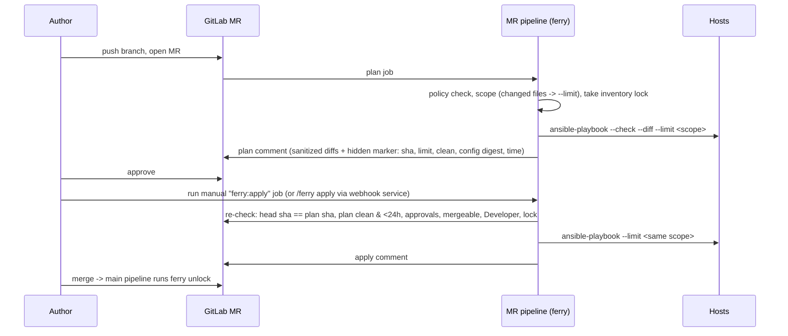

# ferry

Atlantis-style plan/apply for Ansible. An MR gets a check-mode plan (with diffs) as a comment; an
approved MR whose plan is current can be applied; a scheduled drift run reports hosts that no
longer match the default branch. GitLab CI is the first driver; the engine is written so a webhook
service can drive it without changes. GitLab and GitHub backends are included (`--vcs`).

```
ferry plan      # MR pipeline: check --diff on the hosts the MR affects, comment the plan, take the lock
ferry apply     # MR pipeline, manual job: apply if every gate passes, comment the result
ferry drift     # default branch, scheduled: check mode on every host, metrics for Prometheus
ferry unlock    # default branch, after merge: release the merged MR's lock
ferry scope F.. # which hosts/groups a set of changed files maps to
ferry policy    # static checks (no check_mode: false outside allow-list, no pipe lookups, no reboot)
```

## How a change flows



## Gates on apply

All re-checked inside the apply job, against live GitLab state:

- The pipeline's commit is the MR head, and the newest plan (posted by ferry's own account; markers
  from anyone else are ignored) is for that commit, is clean (no failed/unreachable/blocked host),
  is younger than `apply.max_plan_age_hours`, and was made with the same `ferry.yaml`.
- Re-computed scope equals the planned scope.
- MR open, not draft, no conflicts, blocking discussions resolved, not otherwise unmergeable
  (`ci_still_running` is fine: the apply job runs in that pipeline).
- `apply.min_approvals` approvals (the author's own doesn't count unless `allow_author_approval`).
- The person running it has Developer+ (or is in `apply.allowed_users`).
- The MR holds the inventory lock (or the lock is free / its holder MR is closed or merged).

## Locks

One lock per inventory, taken at plan time and held until the MR merges or closes (Atlantis
semantics), so two MRs can't interleave plans and applies on the same hosts. A service keeps them in
its own file (`SQLiteLocks`, `FERRY_LOCK_DB`; Atlantis uses a BoltDB file the same way). CI-only
GitLab driver, which has no storage of its own: an
annotated tag `ferry-lock-<inventory>` (creation is atomic server-side; the message holds the holder).
A lock whose MR is no longer open is stale and taken over automatically. Exclude
`ferry-lock-*` tags from pipelines in the consumer's `workflow:rules`. Use a CI `resource_group`
on apply jobs as a second guard.

## Busy hosts

A failed task whose message starts with `guard.busy_marker` (`FERRY_HOST_BUSY` by default) means
"this host refused to be touched" (e.g. a 3D printer mid-print). ferry shows the host as
**blocked**, not failed: a plan with a blocked host isn't clean (so it can't be applied), an apply
that meets a newly busy host leaves that host alone and reports it blocked while the other hosts
proceed, and drift doesn't write to that host.

## Drift

`ferry drift` runs check mode over the whole inventory at the default branch, then writes
`ansible_drift.prom` into each reachable, non-blocked host's node_exporter textfile directory
(ferry's `drift_report.yml`, which runs `drift.report_pre_role` first, so busy hosts stay
untouched). That is ferry's only write during a drift run. Unreachable/blocked hosts keep their old
file, which goes stale and alerts. It also writes `drift.json` / `drift.prom` locally (CI artifacts).

| metric | meaning |
|---|---|
| `ansible_drift_last_run_timestamp_seconds` | last finished drift check on this host |
| `ansible_drift_changed_tasks` | tasks check mode says would change (0 = matches main) |
| `ansible_drift_failed_tasks` | tasks that failed during the check (the check is broken) |
| `ansible_drift_info{commit}` | commit compared against |

Policy is alert, don't remediate. Auto-remediation would be `ferry apply`-like run of main on
drifted hosts; deliberately not implemented.

## Output safety

Plan/apply comments only contain what passes `ferry.sanitize.Redactor`: no_log results (Ansible
censors them before callbacks; ferry also drops their diff/msg), diffs of sensitive paths
(shadow, keys) suppressed, values of credential-looking env vars masked, and regexes for PEM keys,
Vault/GitLab/Slack/AWS tokens, crypt hashes and `password=...`. The contract is still: put `no_log`
on any task that handles a secret.

## Threat model (read before reusing at work)

A plan runs the MR's code with the inventory's SSH credentials. Check mode limits what tasks do,
but `check_mode: false`, controller-side lookups and custom plugins all run for real. `ferry policy`
catches the obvious ones; it is not a sandbox. In CI-only mode, anyone who can push a branch can
change `.gitlab-ci.yml` too, so the credential is only as safe as push access. That's acceptable for
a single-owner homelab. For a team, run ferry as a service (the webhook driver) that holds the
credential itself, takes `ferry.yaml`/CI config from the default branch rather than the MR, and
requires approval before planning MRs from untrusted authors.

## Running as a service (GitHub App)

`ferry serve` is the Atlantis-style deployment: a long-running service with a GitHub App, holding
its own credentials, so nothing in a PR can change how ferry runs.

```mermaid
sequenceDiagram
  participant GH as GitHub
  participant S as ferry serve
  participant B as OpenBao
  participant H as Hosts
  GH->>S: webhook (signed): PR opened / synchronize, or "/ferry plan|apply"
  S->>S: verify HMAC, dedupe, plan rule, queue (one job at a time)
  S->>GH: fetch default branch (ferry.yaml) + PR at its head SHA (installation token)
  S->>B: login (workload identity) -> token; sign a throwaway SSH key; vault password
  S->>H: ansible-playbook --check --diff --limit <scope> (or apply, after the gates)
  S->>GH: plan / apply comment as the App
  GH->>S: PR closed -> release its locks
```

- **Config from the default branch.** ferry.yaml (scope, apply gates, policy) is read from the
  default branch; only the playbooks come from the PR.
- **Plan rule.** A plan runs the PR's playbooks with root SSH access (check mode, but
  `check_mode: false`, lookups and plugins run for real), so ferry plans automatically only for
  authors with write access. Anyone else's PR waits for `/ferry plan` from someone with write
  access. Drafts and fork PRs aren't planned.
- **Apply** is `/ferry apply [inventory]` and passes every gate above, against live GitHub state.
- **Per-job credentials** (optional, `FERRY_OPENBAO_*`): an OpenBao token from the service's
  workload identity, a throwaway ed25519 key signed by OpenBao's SSH CA, and the ansible-vault
  password; all removed and the token revoked when the job ends.
- **Locks** in the service's SQLite file (`FERRY_LOCK_DB`) on persistent storage; one instance.
- **Drift** every `FERRY_DRIFT_INTERVAL_HOURS` on the default branch.
- `GET /healthz` reports the queue and the last job. Settings: `ferry serve --help`.

Deploy: `Dockerfile` (non-root image with ansible-core and git) and an example Nomad job in
`deploy/nomad/ferry.nomad.hcl`. **To see the whole loop working locally** (OpenBao, Nomad-style
workload identity, SSH certificates, a managed host, a fake GitHub), run `deploy/local/up.sh` and
follow `deploy/local/README.md`. The GitHub App needs contents: read, pull requests and issues: write,
and webhooks for pull_request and issue_comment, delivered to `POST /webhook` with a secret.

The GitLab CI driver (plus `ferry.webhook`'s pipeline trigger) still works as before; `ferry serve`
can also run against GitLab instead of a GitHub App:

## Running as a service (GitLab)

`FERRY_VCS=gitlab ferry serve` (or just set `FERRY_GITLAB_URL`) is the same service with GitLab's
webhook intake; the queue, worker, workspace, credentials and engine are shared.

| Needs | From |
|---|---|
| GitLab base URL, e.g. `https://gitlab.example.com` | `FERRY_GITLAB_URL` |
| the config project, `GROUP/NAME` or numeric id | `FERRY_GITLAB_PROJECT` |
| a project access token, role **Developer**, scopes **`api`** (notes, approvals, members) and **`read_repository`** (checkouts) | `FERRY_GITLAB_TOKEN_FILE` (re-read on use, so it can be rotated) or `FERRY_GITLAB_TOKEN` |
| the webhook's secret token | `FERRY_WEBHOOK_SECRET_FILE` or `FERRY_WEBHOOK_SECRET` |
| the lock file, the default branch, OpenBao, drift | as for GitHub (`ferry serve --help`); the default branch defaults to the project's |

Developer is enough because the service keeps locks in its SQLite file, not in tags (the CI driver
still needs Maintainer for its tag locks). The token reaches git only as an `http.extraHeader`
(Basic `oauth2:<token>`) in the environment, never in a URL, argv or `.git/config`.

Webhook (project **Settings > Webhooks**): URL `https://ferry.example.com/webhook`, a **Secret
token**, triggers **Merge request events** and **Comments**, **Enable SSL verification** on. GitLab
doesn't sign the body; it sends the secret in `X-Gitlab-Token`, which ferry compares in constant
time, so the webhook must use HTTPS. Retries are deduped on `Idempotency-Key` (or
`X-Gitlab-Event-UUID`); deliveries for another project are ignored.

- **Plan** on open, reopen, a push of new commits and draft -> ready, under the same plan rule:
  automatically only for MR authors with Developer+; anyone else's MR gets one note and waits for
  `/ferry plan` from a Developer. Drafts and fork MRs (source project != target project) aren't
  planned automatically. Close or merge releases the MR's locks.
- **Apply** is `/ferry apply [inventory]`, with every gate above. Approvals count only for the
  current head: GitLab doesn't record which commit an approval was for, so ferry counts an approval
  only if its `approved_at` is at or after the moment the head arrived (the MR diff version whose
  head is the MR's SHA). On a GitLab that doesn't report `approved_at`, approvals count only if the
  project removes approvals when commits are added; otherwise none count (and the service logs why).
- **Mergeability** comes from `detailed_merge_status`. `unchecked`, `checking` and `preparing` mean
  GitLab hasn't decided yet: apply is refused, retry. A pending or failed MR pipeline
  (`ci_still_running`, `ci_must_pass`) also refuses in the service, as GitHub's required checks do;
  the CI driver ignores those two because its apply job is part of that pipeline.

## GitHub

`--vcs github` (or `FERRY_VCS=github`) uses `ferry.vcs.github.GitHubBackend` and `SQLiteLocks`:

| Needs | From |
|---|---|
| token (contents read, pull requests + issues write) | `FERRY_GITHUB_TOKEN` |
| the service's lock file, on persistent storage | `FERRY_LOCK_DB` or `--lock-db` |
| repo `OWNER/NAME` | `--project`, `FERRY_GITHUB_REPO` or `GITHUB_REPOSITORY` |
| ferry's own login, for trusting plan markers | `FERRY_GITHUB_BOT` (an App's `<slug>[bot]`); otherwise `GET /user` |
| PR, commit, user | `--mr`, `--sha`, `--user` (no CI variables are trusted for the user) |

Mapping: notes are issue comments; approvals are the latest decisive review per user that approves
the current head; "blocked" merge states are GitHub's `mergeable_state` `dirty`, `blocked`, `behind`,
`draft` and `unknown`; applying needs `write`, `maintain` or `admin`. Locks live in the service's
own SQLite file (like Atlantis's BoltDB), not in the repo: no tags, no repo write access, and one
ferry service per file. Intended deployment is a service holding a GitHub App (see the threat model
above), not `pull_request` workflows.

## Development

```
pip install -e '.[test]' 'ansible-core~=2.20.0'
python -m pytest -q
```

Release: bump `pyproject.toml` version, tag `vX.Y.Z`; CI publishes the wheel to this project's
PyPI registry. Project notes for agents live in `lode/`.
