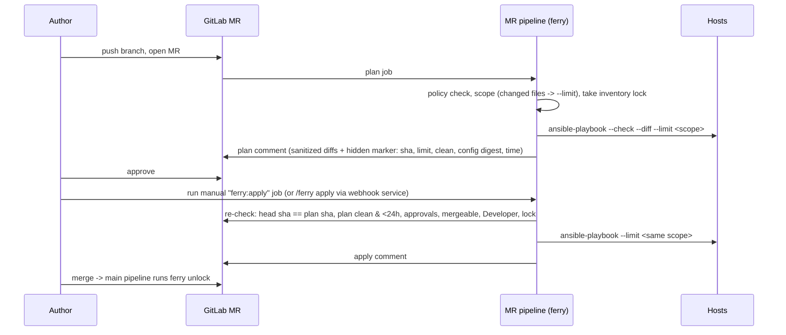

# ferry

Atlantis-style plan/apply for Ansible. An MR gets a check-mode plan (with diffs) as a comment; an
approved MR whose plan is current can be applied; a scheduled drift run reports hosts that no
longer match the default branch. GitLab CI is the first driver; the engine is written so a webhook
service can drive it without changes. GitLab and GitHub backends are included (`--vcs`).

```
ferry plan      # MR pipeline: check --diff on the hosts the MR affects, comment the plan, take the lock
ferry apply     # MR pipeline, manual job: apply if every gate passes, comment the result
ferry drift     # default branch, scheduled: check mode on every host, metrics for Prometheus
ferry unlock    # default branch, after merge: release the merged MR's lock
ferry scope F.. # which hosts/groups a set of changed files maps to
ferry policy    # static checks (no check_mode: false outside allow-list, no pipe lookups, no reboot)
```

## How a change flows



## Gates on apply

All re-checked inside the apply job, against live GitLab state:

- The pipeline's commit is the MR head, and the newest plan (posted by ferry's own account; markers
  from anyone else are ignored) is for that commit, is clean (no failed/unreachable/blocked host),
  is younger than `apply.max_plan_age_hours`, and was made with the same `ferry.yaml`.
- Re-computed scope equals the planned scope.
- The MR targets the default branch, or a branch listed in `base_branches` in the default branch's
  `ferry.yaml` (checked again at apply, so retargeting after the plan is refused). MRs into any
  other branch are never planned or applied: that branch's merge rules, usually none, would be the
  only review gate.
- The MR is up to date with its target branch (`apply.require_up_to_date`, default on; Atlantis
  `undiverged`): GitHub's compare API `behind_by`, GitLab's `diverged_commits_count`, read live at
  apply. Ansible applies whole roles, so a branch that predates a merged change would put the hosts
  back to the older state. A plan of a stale branch carries a warning so the author rebases before
  review. If the code host can't say, the apply is refused.
- MR open, not draft, no conflicts, blocking discussions resolved, not otherwise unmergeable
  (`ci_still_running` is fine: the apply job runs in that pipeline).
- `apply.min_approvals` approvals (the author's own doesn't count unless `allow_author_approval`).
  Nor does one from anyone who wrote part of the change: GitHub's commit author/committer logins
  for the PR, GitLab's push events to the source branch (GitLab records the pusher itself; commit
  author fields are whatever was typed), and every pusher ferry saw in a webhook. This is GitHub's
  "approval of the most recent reviewable push" and GitLab's "prevent approvals by users who add
  commits", held by ferry whether or not the code host has the rule on (GitLab CE doesn't).
  `allow_author_approval: true` is the one opt-out, for solo repos. If the code host can't say who
  pushed, no approval counts. Only approvals from users who could apply themselves count (write on GitHub, Developer+ on GitLab), and ferry's own account never does: on a public GitHub repo anyone can leave an approving review.
- The person running it has Developer+ (or is in `apply.allowed_users`).
- Several inventories: a bare apply applies them in `ferry.yaml` order and **stops at the first one
  that is refused or doesn't apply cleanly**; the rest are listed as not run.
  `apply.require_inventory: true` refuses a bare apply outright (name each inventory). An inventory
  may override `allowed_users` and `min_approvals` for itself:

  ```yaml
  inventories:
    - {name: staging, path: inventories/staging}
    - name: production
      path: inventories/production
      apply: {allowed_users: [alice, bob], min_approvals: 2}
  apply:
    require_inventory: true
  ```
- **GitHub: the code host's own rules would allow the merge**, on top of ferry's approval check
  (both must pass). See [GitHub branch protection and rulesets](#github-branch-protection-and-rulesets).
- The MR holds the inventory lock (or the lock is free / its holder MR is closed or merged).

## Locks

One lock per inventory, taken at plan time and held until the MR merges or closes (Atlantis
semantics), so two MRs can't interleave plans and applies on the same hosts. A service keeps them in
its own file (`SQLiteLocks`, `FERRY_LOCK_DB`; Atlantis uses a BoltDB file the same way). CI-only
GitLab driver, which has no storage of its own: an
annotated tag `ferry-lock-<inventory>` (creation is atomic server-side; the message holds the holder).
A lock whose MR is closed, merged or deleted (a definite 404/410) is stale and taken over
automatically. Any other error while checking the holder (timeout, 5xx, rate limit) refuses and
keeps the lock: it fails closed. Closed and merged MRs are never planned. Exclude
`ferry-lock-*` tags from pipelines in the consumer's `workflow:rules`. Use a CI `resource_group`
on apply jobs as a second guard.

`ferry serve` also takes `/ferry unlock [inventory]` on the MR/PR that holds a lock (write access;
Developer+ on GitLab): it releases the lock (all of this change's locks without an inventory), says
who did it, and is recorded in the job history (`GET /jobs`, action `unlock`). The change's plan
stops counting: apply refuses until it is planned again, so an unlocked plan can't be applied over
whatever planned in between. On a change that doesn't hold the lock, unlock says so and changes
nothing.

## Help and mistyped commands (`ferry serve`)

`/ferry help` lists the commands. A comment that starts with `/ferry` but doesn't parse
(`/ferry aply`, `/ferry plan prod extra`) gets the same list with what ferry didn't understand.
These replies are limited to one per change per 10 minutes, so nobody can make ferry spam a thread.
Comments that don't start with `/ferry` are never answered.

## Busy hosts

A failed task whose message starts with `guard.busy_marker` (`FERRY_HOST_BUSY` by default) means
"this host refused to be touched" (e.g. a 3D printer mid-print). ferry shows the host as
**blocked**, not failed: a plan with a blocked host isn't clean (so it can't be applied), an apply
that meets a newly busy host leaves that host alone and reports it blocked while the other hosts
proceed, and drift doesn't write to that host.

## Drift

`ferry drift` runs check mode over the whole inventory at the default branch, then writes
`ansible_drift.prom` into each reachable, non-blocked host's node_exporter textfile directory
(ferry's `drift_report.yml`, which runs `drift.report_pre_role` first, so busy hosts stay
untouched). That is ferry's only write during a drift run. Unreachable/blocked hosts keep their old
file, which goes stale and alerts. It also writes `drift.json` / `drift.prom` locally (CI artifacts).

| metric | meaning |
|---|---|
| `ansible_drift_last_run_timestamp_seconds` | last finished drift check on this host |
| `ansible_drift_changed_tasks` | tasks check mode says would change (0 = matches main) |
| `ansible_drift_failed_tasks` | tasks that failed during the check (the check is broken) |
| `ansible_drift_info{commit}` | commit compared against |

Policy is alert, don't remediate. Auto-remediation would be `ferry apply`-like run of main on
drifted hosts; deliberately not implemented.

## Output safety

Plan/apply comments only contain what passes `ferry.sanitize.Redactor`: no_log results (Ansible
censors them before callbacks; ferry also drops their diff/msg), diffs of sensitive paths
(shadow, keys) suppressed, values of credential-looking env vars masked, and regexes for PEM keys,
Vault/GitLab/Slack/AWS tokens, crypt hashes and `password=...`. The contract is still: put `no_log`
on any task that handles a secret.

## Threat model

A plan runs the MR's code with the inventory's SSH credentials. Check mode limits what tasks do,
but `check_mode: false`, controller-side lookups and custom plugins all run for real. `ferry policy`
catches the obvious ones; it is not a sandbox. In CI-only mode, anyone who can push a branch can
change `.gitlab-ci.yml` too, so the credential is only as safe as push access. That's acceptable for
a single-owner homelab. For a team, run ferry as a service (the webhook driver) that holds the
credential itself, takes `ferry.yaml`/CI config from the default branch rather than the MR, and
requires approval before planning MRs from untrusted authors.

## Running as a service (GitHub App)

`ferry serve` is the Atlantis-style deployment: a long-running service with a GitHub App, holding
its own credentials, so nothing in a PR can change how ferry runs.

```mermaid
sequenceDiagram
  participant GH as GitHub
  participant S as ferry serve
  participant B as OpenBao
  participant H as Hosts
  GH->>S: webhook (signed): PR opened / synchronize, or "/ferry plan|apply"
  S->>S: verify HMAC, dedupe, plan rule, queue (one job at a time)
  S->>GH: fetch default branch (ferry.yaml) + PR at its head SHA (installation token)
  S->>B: login (workload identity) -> token; sign a throwaway SSH key; vault password
  S->>H: ansible-playbook --check --diff --limit <scope> (or apply, after the gates)
  S->>GH: plan / apply comment as the App
  GH->>S: PR closed -> release its locks
```

- **Config from the default branch.** ferry.yaml (scope, apply gates, policy) is read from the
  default branch; only the playbooks come from the PR.
- **Plan rule.** A plan runs the PR's playbooks with root SSH access (check mode, but
  `check_mode: false`, lookups and plugins run for real), so ferry plans automatically only for
  authors with write access, and for pushes from users with write access. Anyone else's PR (or
  push into a PR) waits for `/ferry plan` from someone with write access. Drafts and fork PRs
  aren't planned.
- **A comment runs the commit it was written about.** `/ferry plan` and `/ferry apply` are pinned
  to the PR head as of the comment's `created_at`, which ferry knows from the signed
  `pull_request` events it received. A head that arrived after the comment, or one ferry never saw
  arrive (a PR older than the service), is refused with a note. `/ferry plan --sha <commit>` names
  the commit outright. If the PR moves while the job is queued, the job doesn't run and says so.
  For someone else's PR the comment vouches for code the commenter read, so it has to be that
  code.
- **Host keys are checked** (the image sets `ANSIBLE_HOST_KEY_CHECKING=True`). Mount known_hosts at
  `/etc/ssh/ssh_known_hosts` in the container that runs the playbooks: pinned keys, or
  `@cert-authority` lines for OpenBao-signed host certificates.
- **Apply** is `/ferry apply [inventory]` and passes every gate above, against live GitHub state.
  The gates run before any credential is minted, so a refused apply costs no OpenBao login and no
  certificate; they run again once the credentials exist.
- **Per-job credentials** (optional, `FERRY_OPENBAO_*`): an OpenBao token from the service's
  workload identity, a throwaway ed25519 key signed by OpenBao's SSH CA, and the ansible-vault
  password; all removed and the token revoked when the job ends.
- **Locks** in the service's SQLite file (`FERRY_LOCK_DB`) on persistent storage; one instance.
  The same file remembers seen deliveries. Closing or merging a PR releases its locks straight
  from that table (no git fetch, no ferry.yaml), unless the PR was reopened by then. **Losing the
  file frees every lock**: back it up with the volume, or expect a second PR to plan meanwhile.
- **Replays:** a delivery is a duplicate if its id *or* its exact signed body was seen before
  (the delivery id isn't covered by the signature), remembered in the state file for 7 days, across
  restarts. Events whose own timestamps (a comment's `created_at`/`updated_at`, a PR's
  `updated_at`) are older than `FERRY_WEBHOOK_MAX_AGE_MINUTES` (10) are refused, so a captured
  body can't be replayed later under a new id.
- **HTTP:** bodies over `FERRY_MAX_BODY_BYTES` (1 MiB) get 413, chunked bodies 411; a connection
  that stalls is dropped after 15 s, and at most 32 are served at once.
- **Drift** every `FERRY_DRIFT_INTERVAL_HOURS` on the default branch.
- `GET /healthz` reports the queue and the last job. Settings: `ferry serve --help`.

**Edge routing:** `/jobs` and `/metrics` must never be publicly routed. They are unauthenticated
internal audit/monitoring endpoints; use private-network access and scrape them internally.
Allow only authenticated `POST /api/runs` and `POST /api/runs/{id}/lease|finish` at the operator
edge; add `POST /webhook` only when enabling code-host hooks, with source restrictions.
Deny every other path/method, including `/healthz` at the public edge. The current service uses
one listener (no separate `FERRY_API_LISTEN`); enforce the split in your ingress/reverse proxy.
Do not expose its backend port directly. The Nomad example has an explicit path allowlist.

Deploy: `Dockerfile` (non-root image with ansible-core and git) and an example Nomad job in
`deploy/nomad/ferry.nomad.hcl`. **To see the whole loop working locally** (OpenBao, Nomad-style
workload identity, SSH certificates, a managed host, a fake GitHub), run `deploy/local/up.sh` and
follow `deploy/local/README.md`. The GitHub App's permissions are below; it needs webhooks for
pull_request and issue_comment, delivered to `POST /webhook` with a secret.

| App permission | Why |
|---|---|
| Contents: read | fetch the default branch and the PR head |
| Pull requests: write | read PRs, reviews and the review decision (GraphQL `reviewDecision`) |
| Issues: write | plan / apply comments |
| Metadata: read (always granted) | collaborator permission; the branch's active rulesets |
| Checks: read, Commit statuses: read | which required checks passed on the PR head |
| Administration: read | classic branch protection rules (only if the target branch uses classic protection; ferry refuses to apply until it can read them) |

Don't give the App a bypass on the branch's rulesets: it doesn't need one, and GitHub computes the
merge state for the viewer.

The GitLab CI driver (plus `ferry.webhook`'s pipeline trigger) still works as before; `ferry serve`
can also run against GitLab instead of a GitHub App:

## Running as a service (GitLab)

`FERRY_VCS=gitlab ferry serve` (or just set `FERRY_GITLAB_URL`) is the same service with GitLab's
webhook intake; the queue, worker, workspace, credentials and engine are shared.

| Needs | From |
|---|---|
| GitLab base URL, e.g. `https://gitlab.example.com` | `FERRY_GITLAB_URL` |
| the config project, `GROUP/NAME` or numeric id | `FERRY_GITLAB_PROJECT` |
| a project access token, role **Developer**, scopes **`api`** (notes, approvals, members) and **`read_repository`** (checkouts) | `FERRY_GITLAB_TOKEN_FILE` (re-read on use, so it can be rotated) or `FERRY_GITLAB_TOKEN` |
| the webhook's secret token | `FERRY_WEBHOOK_SECRET_FILE` or `FERRY_WEBHOOK_SECRET` |
| the lock file, the default branch, OpenBao, drift | as for GitHub (`ferry serve --help`); the default branch defaults to the project's |

Developer is enough because the service keeps locks in its SQLite file, not in tags (the CI driver
still needs Maintainer for its tag locks). The token reaches git only as an `http.extraHeader`
(Basic `oauth2:<token>`) in the environment, never in a URL, argv or `.git/config`.

Webhook (project **Settings > Webhooks**): URL `https://ferry.example.com/webhook`, a **Secret
token**, triggers **Merge request events** and **Comments**, **Enable SSL verification** on. GitLab
doesn't sign the body; it sends the secret in `X-Gitlab-Token`, which ferry compares in constant
time, so the webhook must use HTTPS. Retries are deduped on `Idempotency-Key` (or
`X-Gitlab-Event-UUID`) and on the body, in the state file. A note triggers at most one job:
commands are also deduped on the note id (`note:<project>:<id>`), so a replay re-encoded under a
fresh key is refused as `duplicate comment` (GitHub comments likewise, on the comment id). Notes and MR events older than
`FERRY_WEBHOOK_MAX_AGE_MINUTES` are refused; deliveries for another project are ignored.

- **Plan** on open, reopen, a push of new commits and draft -> ready, under the same plan rule:
  automatically only for MR authors with Developer+; anyone else's MR gets one note and waits for
  `/ferry plan` from a Developer. Drafts and fork MRs (source project != target project) aren't
  planned automatically. Close or merge releases the MR's locks.
- **Notes are pinned to the head the commenter saw**, as on GitHub: the hook's
  `merge_request.last_commit` must still be the MR head, and that head's diff version must predate
  the note (`--sha <commit>` names it instead).
- **Apply** is `/ferry apply [inventory]`, with every gate above. Approvals count only for the
  current head: GitLab doesn't record which commit an approval was for, so ferry counts an approval
  only if its `approved_at` is at or after the moment the head arrived (the MR diff version whose
  head is the MR's SHA). On a GitLab that doesn't report `approved_at`, approvals count only if the
  project removes approvals when commits are added; otherwise none count (and the service logs why).
- **Mergeability** comes from `detailed_merge_status`. `unchecked`, `checking` and `preparing` mean
  GitLab hasn't decided yet: apply is refused, retry. A pending or failed MR pipeline
  (`ci_still_running`, `ci_must_pass`) also refuses in the service, as GitHub's required checks do;
  the CI driver ignores those two because its apply job is part of that pipeline.

## Commit statuses: merge only what was applied (`ferry serve`)

With `FERRY_COMMIT_STATUS=1`, ferry posts commit statuses on the PR head, one pair per inventory:

| Status | pending | success | failure |
|---|---|---|---|
| `ferry/plan: <inventory>` | planning | plan is clean, or no host affected | not clean, or refused |
| `ferry/apply: <inventory>` | planned, not applied yet; applying | applied, or nothing to apply | apply had failures |

A new push has no statuses until ferry plans it, so a required `ferry/apply: <inventory>` blocks
the merge until that exact head is applied. GitHub: add it to the branch's required status checks
(ruleset or branch protection) and give the App **Commit statuses: write**. GitLab: with "Pipelines
must succeed", the pending `ferry/apply` status holds the merge until the apply succeeds (needs
Developer, which ferry's token already has).

ferry's own statuses never block ferry's own apply: on GitHub, checks and statuses posted by ferry's
App are ignored by the merge-rule gate (as `FERRY_GITHUB_OWN_CHECKS`); on GitLab, a "pipeline must
succeed" blocker is ignored when every status that isn't green is a `ferry/` status posted by
ferry's own account. A status with ferry's name from anyone else counts like any other. Without the
permission ferry logs once and carries on without statuses.

## Switching applies off (`ferry serve`)

For an incident, a change freeze or a suspected compromise of a writer's account, without stopping
the service (locks are still released on close and drift still runs):

| Switch | How | Effect |
|---|---|---|
| `FERRY_ALLOW_COMMANDS=plan` | environment (restart) | plan-only ferry: `/ferry apply` is refused |
| `FERRY_DISABLE_AUTOPLAN=1` | environment (restart) | plans only on `/ferry plan`, never on push |
| `disable-apply` file | `ferry switch apply off --reason "..."` | applies refused at once, queued ones too |
| `disable-autoplan` file | `ferry switch autoplan off` | pushes no longer plan, queued autoplans dropped |

The files live in `FERRY_SWITCH_DIR` (default: the directory of `FERRY_LOCK_DB`, on the state
volume). ferry checks them on every webhook and again before each queued job runs, so a switch also
stops jobs already in the queue; a directory it can't check counts as switched off. In Kubernetes:

```sh
kubectl -n ferry exec deploy/ferry -c ferry -- ferry switch apply off --reason "change freeze until Monday"
kubectl -n ferry exec deploy/ferry -c ferry -- ferry switch            # show
kubectl -n ferry exec deploy/ferry -c ferry -- ferry switch apply on
```

A refused command gets a note on the PR ("applies are disabled on this ferry: change freeze until
Monday"). `GET /healthz` shows `"switches": {"plan": true, "apply": false, "autoplan": true}` and
`/metrics` has `ferry_enabled{switch="apply"}`. None of this is in `ferry.yaml`, so a merge can't
flip it.

## Observability (`ferry serve`)

Both backends serve, on the same port as the webhook:

- `GET /metrics`: Prometheus text format.

  | Metric | Type | Labels |
  |---|---|---|
  | `ferry_jobs_total` | counter | `action` (plan, apply, unlock, drift), `result` (ok, failed, refused, skipped, error) |
  | `ferry_job_duration_seconds` | histogram | `action` |
  | `ferry_jobs_queued_total` | counter | `action` |
  | `ferry_webhook_rejected_total` | counter | `reason` (bad_auth, duplicate, stale, future, undated, bad_json, foreign_repo, no_access, head_moved, queue_full, too_large, bad_request) |
  | `ferry_last_job_timestamp_seconds` | gauge | `action` |
  | `ferry_queue_depth`, `ferry_locks_held` | gauge | |
  | `ferry_build_info` | gauge | `version` |

  `refused` means a gate said no and nothing ran. `failed` means ansible ran and wasn't clean.
  `skipped` means the PR moved on. `error` means ferry couldn't finish (the service log says why).
- `GET /jobs[?limit=N]`: the newest finished jobs (up to 200) as JSON, read-only, kept in the
  state file (`FERRY_JOB_HISTORY`, default 200). Each entry has the action, PR, short SHA, user,
  inventory, result, start time and duration.
- `GET /healthz`: the queue depth and the last job.

Every label value comes from a fixed set. Usernames, commits, branches, error text, URLs and
credentials never appear in `/metrics`. `/jobs` holds no error text or refusal reasons (those go
on the PR and in the log). The three endpoints are unauthenticated: expose only `/webhook`
publicly, and scrape the rest from inside the cluster.

Example alerts: `increase(ferry_jobs_total{result="error"}[1h]) > 0`,
`ferry_queue_depth > 5` for 15m, and
`increase(ferry_webhook_rejected_total{reason=~"bad_auth|stale"}[1h]) > 0` (someone is sending
forged or replayed deliveries).

## Container image

`ghcr.io/jfryman/ferry`, built by GitHub Actions for **linux/amd64** and **linux/arm64**, with SBOM
and provenance attestations. It's non-root (uid 10001 `ferry`; uid 10002 `ferry-run` for the
executor), with ansible-core, git and ssh installed. Collections are installed per `requirements.yml` at run time.

| Tag | Built from |
|---|---|
| `vX.Y.Z`, `X.Y`, `latest` | release tags |
| `edge`, `sha-<short>` | every push to `main` |

Pin a digest in production: `ghcr.io/jfryman/ferry:v0.2.0@sha256:...`.

**One image, two commands.** The default command is `serve`. The executor is the same image run
with `executor`, as another user, in its own container (see the next section):

```bash
docker run ... ghcr.io/jfryman/ferry:v0.2.0                    # ferry serve
docker run -u 10002 ... ghcr.io/jfryman/ferry:v0.2.0 executor  # ferry executor
```

Host keys are checked (`ANSIBLE_HOST_KEY_CHECKING=True`). Mount known_hosts at
`/etc/ssh/ssh_known_hosts` in whichever container runs the playbooks: the executor, or the service
if you run without one.

## Playbooks run apart from the service (`ferry executor`)

A plan runs the change's own playbooks, and a playbook can run code on the controller: lookups,
`delegate_to: localhost`, `check_mode: false` tasks, plugins in the repo. Run as the service, that
code could read the App key or GitLab token, the webhook secret, the workload identity token and
the lock file. So with `FERRY_EXECUTOR_SOCKET` set, `ferry serve` doesn't run ansible itself:
`ferry executor` does, as another user (`ferry-run`, uid 10002 in the image), in its own container
that mounts none of those secrets.

- The two share the work dir (read-only for the executor; the files belong to the service's user
  anyway) and the socket's directory. Per job the service sends the ansible-playbook arguments, the
  job's own environment (never the service's) and the contents of the job's credential files. The
  executor writes those into a private per-job directory, runs the play, streams the output back and
  deletes the directory.
- The job's OpenBao token is revoked as soon as the certificate and vault password are fetched,
  before any playbook runs. To give playbooks a token for `community.hashi_vault` lookups, set
  `FERRY_OPENBAO_PLAYBOOK_TOKEN=1`. That token can sign more certificates until it expires.
- As its container's PID 1, the executor kills every other process in the container after each job.
  It also binds its socket again if a playbook replaced it, so nothing a playbook leaves behind sees
  the next job's credentials.
- `FERRY_EXECUTOR_MUST_NOT_READ` lists service secret paths. The executor refuses to start if it can
  read any of them, or if it runs as root.
- **Inherent:** the playbook can read the job's SSH key, certificate and vault password. It needs
  them. Keep the certificate short (`FERRY_OPENBAO_SSH_TTL`) and its principal narrow.

Why a second container rather than only a second user in the same one: switching users needs root
or `CAP_SETUID` in the service's container, and the service's secret files would still sit on the
same filesystem, guarded only by modes. A second container needs no privileges anywhere, and the
secrets aren't there at all. It works the same in Kubernetes (a second container in the pod) and
Nomad (a sidecar task, see `deploy/nomad`). A pod or job per run would also work, but the service
would then need the right to create pods or submit jobs, which is a bigger grant than the one it
protects. In the local lab, `deploy/local/lab.sh evil` and then `leakcheck` run a hostile plan and
show what it got.


The change's `requirements.yml` is installed there too: the service asks the executor, which runs
`ansible-galaxy collection install` into its own writable cache (`FERRY_EXECUTOR_COLLECTIONS`) with
a minimal environment (no `FERRY_*`, no tokens, a throwaway `HOME`) and a hard timeout
(`FERRY_GALAXY_TIMEOUT_SECONDS`, default 300, kills everything it started). `FERRY_GALAXY=skip`
never reads `requirements.yml` (images that ship their collections). `FERRY_GALAXY_SERVER` pins
the Galaxy server and refuses requirements that name URLs, git, files or another `source:`. Cache
entries unused for `FERRY_COLLECTIONS_MAX_AGE_DAYS` (14) are pruned. Git fetches have a timeout too
(`FERRY_GIT_TIMEOUT_SECONDS`, 300). Without an executor, the same install runs in the service with
the same minimal environment.
## GitHub

`--vcs github` (or `FERRY_VCS=github`) uses `ferry.vcs.github.GitHubBackend` and `SQLiteLocks`:

| Needs | From |
|---|---|
| token (contents read, pull requests + issues write) | `FERRY_GITHUB_TOKEN` |
| the service's lock file, on persistent storage | `FERRY_LOCK_DB` or `--lock-db` |
| repo `OWNER/NAME` | `--project`, `FERRY_GITHUB_REPO` or `GITHUB_REPOSITORY` |
| ferry's own login, for trusting plan markers | `FERRY_GITHUB_BOT` (an App's `<slug>[bot]`); otherwise `GET /user` |
| PR, commit, user | `--mr`, `--sha`, `--user` (no CI variables are trusted for the user) |

Mapping: notes are issue comments; approvals are the latest decisive review per user that approves
the current head; "blocked" merge states are GitHub's `mergeable_state` `dirty`, `behind`, `draft`
and `unknown` (`blocked` is explained rule by rule, below); applying needs `write`, `maintain` or `admin`. Locks live in the service's
own SQLite file (like Atlantis's BoltDB), not in the repo: no tags, no repo write access, and one
ferry service per file. Intended deployment is a service holding a GitHub App (see the threat model
above), not `pull_request` workflows.

### GitHub branch protection and rulesets

On apply, ferry also asks GitHub whether the PR could merge under the target branch's classic branch
protection and active rulesets, and refuses with a comment naming the unmet rule. ferry's own check
(an approval of the current head from someone with write access) still applies: both must pass.

ferry uses GitHub's own verdict where GitHub computes one, and reads the rules to name what's unmet:

| Rule | How ferry checks it |
|---|---|
| Required approving reviews, CODEOWNERS review, dismiss stale reviews, last-push approval, requested changes | GraphQL `reviewDecision` must be `APPROVED` when any review rule applies. The comment names the count and the code owners still requested. |
| Required status checks | Each check required by a rule, or marked `isRequired` by GitHub, must have passed (success, neutral, skipped) on the head, from the pinned App if the rule pins one. |
| Conversation resolution | No unresolved review threads. |
| Anything else (`mergeStateStatus` `BLOCKED`) | If GitHub says blocked and none of the above explains it, ferry refuses, listing rules it can't evaluate (merge queue, required deployments, signed commits, locked branch). |

**ferry's own required check.** If a branch requires a check that only passes once ferry has applied
(a ferry status, or the CI job that runs `ferry apply`), requiring it would deadlock the apply. ferry
ignores a required check that was posted by its own App (`FERRY_GITHUB_APP_ID`, or the bot login) or
whose name is in `FERRY_GITHUB_OWN_CHECKS` (comma-separated, from the service's environment, never
from the repo). A `BLOCKED` merge state explained only by such a check doesn't refuse the apply.

**Fails closed.** If ferry can't read a rule source (a missing App permission, an API error, more
than 100 checks or review threads), it refuses and names the App permission to add.

**Gaps.** ferry's checks are by name: a check name from another App satisfies an unpinned required
check, as on GitHub. Rules ferry can't evaluate are trusted to GitHub's merge state, which is computed
for the App (so an App with bypass would see `CLEAN`). Required linear history, the merge method and
push restrictions don't affect whether a PR may merge, so they aren't checked. "Require branches to be
up to date" is GitHub's `behind` state, already refused.

## Development

```
pip install -e '.[test]' 'ansible-core~=2.20.0'
python -m pytest -q
```

Release: see `lode/practices.md`. In short: bump the version in `pyproject.toml` and
`ferry.__version__`, add a `CHANGELOG.md` entry, merge, then push an annotated tag `vX.Y.Z`. GitHub
Actions builds and pushes the image, and you create a GitHub release from the changelog entry.
Project notes for agents live in `lode/`.

## Operator runs (`ferry run`)

Run a **trusted** playbook on your machine, through the running service's inventory lock,
SSH signer and audit, without a webhook:

```sh
ferry run -i staging --service https://ferry.example.com site.yml          # --check --diff
ferry run -i staging --service https://ferry.example.com --apply site.yml  # explicit write
```

The tree must be clean (including untracked files) and HEAD reachable from an origin branch after
fetching. The CLI generates a throwaway ed25519 key, renews its service lease, uses a private SSH
ControlPath, and finishes and deletes its credential directory on exit, SIGINT or SIGTERM.
SIGKILL cannot run cleanup: the service expires its lease. A failed renewal terminates Ansible.
Use HTTPS and pin SSH host keys; `--insecure-http` disables both checks **only for the throwaway lab**.

The API is off unless **both** `FERRY_RUN_OIDC_ISSUER` and `FERRY_RUN_OIDC_AUDIENCE` are configured.
The issuer is OpenBao's identity issuer (for example `https://bao.example.com/v1/identity/oidc`),
not the login/auth endpoint. Ferry reads `<issuer>/.well-known/keys` and accepts **RS256 only**;
configure the OpenBao identity key accordingly. Signature, issuer, audience and expiry are checked
on every call. Issuance/activation (`iat`/`nbf`) allow 30 seconds of clock skew; expiry
never does. A person has no SSH signing permission and sends ferry an **identity JWT**, never
an OpenBao API token. No webhook signature authorizes these API routes, or vice versa.

Authorization requires both:
- `FERRY_RUN_ALLOWED_SUBJECTS` (comma-separated entity IDs) or `FERRY_RUN_ALLOWED_GROUPS`
  (comma-separated strings in a signed `groups` claim); and
- an explicit matching subject or group in default-branch `ferry.yaml` for the inventory:

```yaml
inventories:
  - name: staging
    path: inventories/staging
    apply:
      run_allowed: [operators] # both check and apply; [] refuses both
apply:
  run_allowed: [] # default for inventories without an override
```

`POST /api/runs` accepts `{inventory, limit, mode: check|apply, sha, public_key}` and returns only
that run's ID, certificate, vault password, inventory path and lease expiry. Lease and finish are
`POST /api/runs/{id}/lease` and `/finish`; only the starting subject may use them. Start also requires a bounded repo-relative `playbook` path (client-asserted, not attested). Finish accepts
`{ok, counts}`; results are operator-reported, not independent execution attestation.
An `apply` must name the current default-branch head (the service checks it against its own fetch
and answers 409 otherwise), so a rule-following operator applies only merged code; check mode may
name any published SHA. Empty entries in `FERRY_RUN_ALLOWED_SUBJECTS`/`_GROUPS`, and empty group
claims, never match.
CLI check versus apply is **client-chosen**, not enforced by the certificate: both receive the
same inventory credential. Scheduled drift now takes the same inventory lock before minting
credentials and records/skips held inventories. After service restart, stale `drift` holders are
recovered once the configured serial executor acknowledges an idle barrier (after prior job cleanup).
Busy/unreachable/old executors retain the lock and retry; recovery runs once per service lifetime,
never against a new active drift. With **no executor**, recovery fails closed: before manually
releasing a stale drift row, the operator must stop/verify all old local Ansible processes are gone.
An automatic local recovery cannot safely infer that from the service PID alone. Therefore `ferry switch apply off` or `FERRY_ALLOW_COMMANDS=plan`
refuses **all new CLI runs, including check**. It does not revoke already-issued credentials. A PR lock refuses a run; a run lock refuses a PR.
`FERRY_RUN_LEASE_SECONDS` defaults to 300; renewal never extends past the signed certificate's
actual expiry. SQLite persists leases across restarts. There are no tokens or passwords in state.
`FERRY_RUN_NAME_CLAIM` selects a signed display-name claim (default `name`). The service strips
Unicode control/format characters, collapses whitespace and bounds it to 128 characters; missing,
non-string or empty names fall back to `sub`. Authorization and run ownership always use stable
`sub`, never the display name. Lock holders show both; names are not metric labels.
`/jobs` records an `issued` event when credentials are returned, then a completion/expiry event.
Issuance is audit only, not an extra finish metric. It records `trigger: cli`, subject, `display_name`,
client-asserted `playbook`, run ID, inventory, limit, mode, full SHA, result and the
certificate **serial**. The role still owns `key_id_format`: match sshd's serial to the audit.
`ferry_jobs_by_trigger_total{trigger="cli",action="plan|apply",result="..."}` counts finishes.
Keep `/jobs` and `/metrics` private and off public routes (see deployment guidance above).

### Admin-token demo login (Google OIDC later)

`deploy/local/up.sh` provisions the complete demo. An admin configures an RS256 identity key,
identity role `ferry` with audience `ferry`, an entity, an entity alias on the token auth mount,
and a token role `ferry-operator` with `allowed_entity_aliases` restricted to that alias. Its policy
can **only** read `identity/oidc/token/ferry`, not sign SSH certificates or read vault secrets.
Then, using the admin credential **outside the playbook's environment**:

```sh
bao token create -role=ferry-operator -entity-alias=demo
# Log in with the resulting operator token, not the admin token:
bao login
bao read -field=token identity/oidc/token/ferry
ferry run -i staging --service https://ferry.example.com site.yml
```

The CLI defaults to `bao read -field=token identity/oidc/token/ferry` (this endpoint is GET, not
`bao write`). Override with `--token-command` or `FERRY_RUN_TOKEN_COMMAND`; arguments are parsed
without a shell. Google OIDC can later authenticate the same entity; the service is unchanged.

**Security limits:** check/apply mode is a client assertion, not a credential restriction; the apply
switch therefore gates both CLI modes. A stolen identity JWT can request credentials for allowed inventories until it
expires, and renew or finish that subject's runs. A run ID alone grants nothing. Certificates cannot
be revoked by finishing or missing a lease: an abandoned client may retain host access until the
certificate expires, and existing SSH sessions may survive it. Lease expiry frees serialization,
not host access. Keep certificate TTLs short, restrict principals and monitor sshd serials.
The playbook runs as your local user: it can read its own key/password **and any files accessible
to your user**, including login-token files. A minimal child environment and temporary HOME are
hygiene, not a sandbox. CLI stdout/stderr are merged at the OS pipe (preserving observed write order), continuously drained,
and buffered up to **1 MiB** in memory before whole-output redaction (including every non-empty
fetched vault password, certificate and private key, regardless of length). Output appears after
Ansible exits. If the limit is exceeded, **all captured output is withheld** and an explicit truncation
notice is printed; this avoids exposing a partial secret/PEM prefix. Whole-output buffering is deliberate:
arbitrary configured regexes and multiline credentials cannot be safely streamed with a fixed window. Redaction is a safety net: use `no_log: true` and
`diff: false` on secret-bearing tasks; arbitrary transformed values and sensitive diffs cannot be
reliably inferred by text filtering. Use a dedicated operator account/container for untrusted code; the lab does.
The client SHA/limit/mode and result are audit assertions by an authorized operator, not proof that
an arbitrary client ran those exact bytes. Protect operator identities as privileged credentials.
