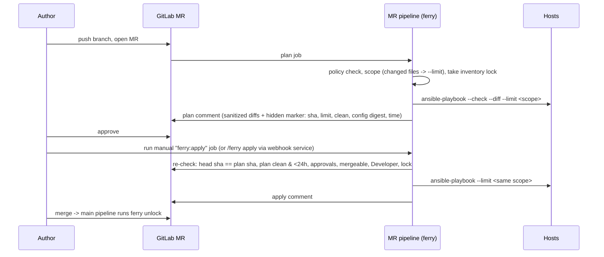

# ferry

Atlantis-style plan/apply for Ansible. An MR gets a check-mode plan (with diffs) as a comment; an
approved MR whose plan is current can be applied; a scheduled drift run reports hosts that no
longer match the default branch. GitLab CI is the first driver; the engine is written so a webhook
service (and a GitHub backend) can be added without touching it.

```
ferry plan      # MR pipeline: check --diff on the hosts the MR affects, comment the plan, take the lock
ferry apply     # MR pipeline, manual job: apply if every gate passes, comment the result
ferry drift     # default branch, scheduled: check mode on every host, metrics for Prometheus
ferry unlock    # default branch, after merge: release the merged MR's lock
ferry scope F.. # which hosts/groups a set of changed files maps to
ferry policy    # static checks (no check_mode: false outside allow-list, no pipe lookups, no reboot)
```

## How a change flows



## Gates on apply

All re-checked inside the apply job, against live GitLab state:

- The pipeline's commit is the MR head, and the newest plan (posted by ferry's own account; markers
  from anyone else are ignored) is for that commit, is clean (no failed/unreachable/blocked host),
  is younger than `apply.max_plan_age_hours`, and was made with the same `ferry.yaml`.
- Re-computed scope equals the planned scope.
- MR open, not draft, no conflicts, blocking discussions resolved, not otherwise unmergeable
  (`ci_still_running` is fine: the apply job runs in that pipeline).
- `apply.min_approvals` approvals (the author's own doesn't count unless `allow_author_approval`).
- The person running it has Developer+ (or is in `apply.allowed_users`).
- The MR holds the inventory lock (or the lock is free / its holder MR is closed or merged).

## Locks

One lock per inventory, taken at plan time and held until the MR merges or closes (Atlantis
semantics), so two MRs can't interleave plans and applies on the same hosts. GitLab backend: an
annotated tag `ferry-lock-<inventory>` (creation is atomic server-side; the message holds the holder).
A lock whose MR is no longer open is stale and taken over automatically. Exclude
`ferry-lock-*` tags from pipelines in the consumer's `workflow:rules`. Use a CI `resource_group`
on apply jobs as a second guard.

## Busy hosts

A failed task whose message starts with `guard.busy_marker` (`FERRY_HOST_BUSY` by default) means
"this host refused to be touched" (e.g. a 3D printer mid-print). ferry shows the host as
**blocked**, not failed: a plan with a blocked host isn't clean (so it can't be applied), an apply
that meets a newly busy host leaves that host alone and reports it blocked while the other hosts
proceed, and drift doesn't write to that host.

## Drift

`ferry drift` runs check mode over the whole inventory at the default branch, then writes
`ansible_drift.prom` into each reachable, non-blocked host's node_exporter textfile directory
(ferry's `drift_report.yml`, which runs `drift.report_pre_role` first, so busy hosts stay
untouched). That is ferry's only write during a drift run. Unreachable/blocked hosts keep their old
file, which goes stale and alerts. It also writes `drift.json` / `drift.prom` locally (CI artifacts).

| metric | meaning |
|---|---|
| `ansible_drift_last_run_timestamp_seconds` | last finished drift check on this host |
| `ansible_drift_changed_tasks` | tasks check mode says would change (0 = matches main) |
| `ansible_drift_failed_tasks` | tasks that failed during the check (the check is broken) |
| `ansible_drift_info{commit}` | commit compared against |

Policy is alert, don't remediate. Auto-remediation would be `ferry apply`-like run of main on
drifted hosts; deliberately not implemented.

## Output safety

Plan/apply comments only contain what passes `ferry.sanitize.Redactor`: no_log results (Ansible
censors them before callbacks; ferry also drops their diff/msg), diffs of sensitive paths
(shadow, keys) suppressed, values of credential-looking env vars masked, and regexes for PEM keys,
Vault/GitLab/Slack/AWS tokens, crypt hashes and `password=...`. The contract is still: put `no_log`
on any task that handles a secret.

## Threat model (read before reusing at work)

A plan runs the MR's code with the inventory's SSH credentials. Check mode limits what tasks do,
but `check_mode: false`, controller-side lookups and custom plugins all run for real. `ferry policy`
catches the obvious ones; it is not a sandbox. In CI-only mode, anyone who can push a branch can
change `.gitlab-ci.yml` too, so the credential is only as safe as push access. That's acceptable for
a single-owner homelab. For a team, run ferry as a service (the webhook driver) that holds the
credential itself, takes `ferry.yaml`/CI config from the default branch rather than the MR, and
requires approval before planning MRs from untrusted authors.

## Growing into a service

- `ferry.engine.Engine` takes a `Config`, a `VCSBackend` (`ferry.vcs.base`), a `LockStore`
  (`ferry.locks`) and a `Runner` (`ferry.runner`). Nothing in it reads CI variables.
- `ferry.webhook` parses GitLab note events (`/ferry plan`, `/ferry apply [inventory]`), verifies
  the webhook secret and triggers a pipeline with `FERRY_ACTION` / `FERRY_MR_IID` / `FERRY_USER`.
  The CLI trusts `FERRY_USER` only on `trigger` pipelines. `webhook.serve()` is a minimal stdlib
  server to try it; the next step is running the engine in the service itself.
- New backend = implement `VCSBackend` (8 methods) and, optionally, a `LockStore`.

## Development

```
pip install -e '.[test]' 'ansible-core~=2.20.0'
python -m pytest -q
```

Release: bump `pyproject.toml` version, tag `vX.Y.Z`; CI publishes the wheel to this project's
PyPI registry. Project notes for agents live in `lode/`.
