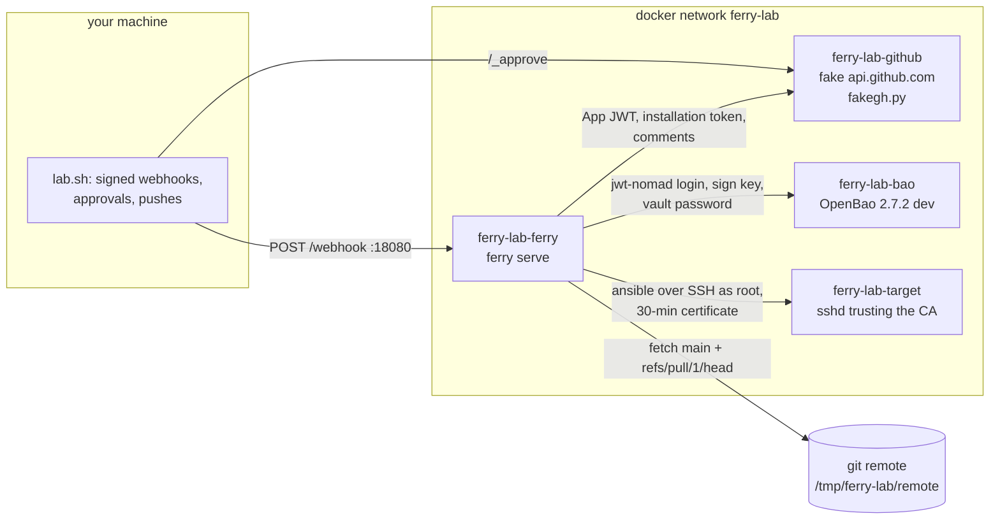

# ferry local lab: the full service loop, OpenBao and SSH certificates

One command stands up everything a production ferry deployment has, in Docker on one machine, so
you can replicate the setup, poke at it and change ferry based on what you find. It was built and
run from scratch on Nov 23, 2026; the walkthrough below is that run's output, trimmed.

Needs: Docker, bash, git, curl, openssl. Nothing is installed on the host; Python runs in the images.

```bash
deploy/local/up.sh        # ~15 s after the first image build; re-run to start from scratch
deploy/local/lab.sh open  # GitHub says: PR #1 opened by pip (who has write access)
deploy/local/lab.sh comments
deploy/local/down.sh      # stop; the lab dir (/tmp/ferry-lab, or $LAB_DIR) is kept for inspection
```

## What's running



| Lab piece | What it stands in for in production |
|---|---|
| `ferry-lab-ferry` (this repo's `Dockerfile`) | The ferry Nomad job (`deploy/nomad/ferry.nomad.hcl` is the starting point; the real one lives in your infrastructure-as-code repo) |
| `fakegh.py` on :18999 | api.github.com plus the GitHub App. It answers `/app`, the installation token, PR, files, reviews, comments, collaborator permission, the branch's rulesets and the GraphQL review decision for PR #1. Writers: `james`, `pip`. |
| `/tmp/ferry-lab/remote/acme/ansible.git` with `refs/pull/1/head` | your config repo on GitHub (ferry fetches with `FERRY_GITHUB_GIT_URL=file:///remote`) |
| `ferry-lab-bao`, dev mode, root token `lab` | your OpenBao cluster |
| `ssh-client-signer/` mount, role `ferry`, policy `ssh-sign-ferry` (set by `up.sh` with the CLI) | your OpenBao config (terraform or CLI): the same values |
| `auth/jwt-nomad`, role `ferry`, static public key; `mkjwt.py` mints the token | Nomad workload identity: the job's `identity { aud = ["openbao.io"] file = true }`, validated against Nomad's JWKS, bound on `nomad_job_id = ferry` |
| `secret/ansible/vault-password` (dev kv-v2) | the vault password at the path you set in `FERRY_OPENBAO_VAULT_PASSWORD_PATH` (any kv-v2 mount) |
| `ferry-lab-target` (`target/Dockerfile`) | Every managed host once its sshd trusts the SSH user CA: `TrustedUserCAKeys`, and root accepts only principal `ferry`. No authorized_keys at all here, so any login is a certificate login. |
| `/tmp/ferry-lab/state/locks.db` | The ferry job's host volume (`FERRY_LOCK_DB`) |
| The config repo `up.sh` writes (one host, a `motd` role, one vaulted var) | your config repo with its `ferry.yaml` |

## The loop, step by step

Each `lab.sh` command delivers what GitHub would, then waits for ferry's job and prints `/healthz`.

1. **`lab.sh open`**: `pull_request.opened` by `pip`.
   - ferry verifies the HMAC and sees `pip` has write access, so it queues a plan.
   - The job fetches `main`, reads `ferry.yaml` from there, and fetches the PR at its exact head SHA.
   - It logs in to OpenBao with the JWT, generates a throwaway ed25519 key, gets a certificate (principal `ferry`, 30 minutes), and reads the vault password.
   - It runs `ansible-playbook --check --diff --limit target` over SSH as root, posts the plan comment as `ferry-lab[bot]`, and takes the lock.
   - **Check:** `lab.sh comments`, `lab.sh sshlog`, `lab.sh locks`.
     ```
     Accepted publickey for root ... ED25519-CERT ... ID jwt-nomad-global:default:ferry:ferry:ferry:openbao (serial ...)
     [('lab', 1, 'e39bc779...', 'pip', 1795475332.5)]
     ```
2. **`lab.sh apply`**: `/ferry apply` from `james`. It's refused: `needs 1 approval(s) from someone other than the author, has 0`.
3. **`lab.sh approve`, then `lab.sh apply`**: applied.
   - **Check:** `lab.sh motd` shows `motd: hello from the PR` and `vaulted secret: s3cret-from-vault`. The second line proves the vault password reached the job; the comment shows that task as `no_log` with details hidden.
4. **`lab.sh push "hello again"`**: a new commit on the PR branch, then `synchronize`. ferry plans the new head.
   - `lab.sh apply` is now refused, because james's approval was for the old head.
5. **`lab.sh open mallory`**: a PR event from a user without write access. ferry posts one "waiting for `/ferry plan`" comment and doesn't plan. `lab.sh plan mallory` is refused; `lab.sh plan` (james) plans.
6. **`lab.sh close`**: the lock is released (`lab.sh locks` returns `[]`).

## Finding from the first run (fixed in this PR)

**SSH connection sharing leaked across jobs.** With Ansible's default ControlPath (`~/.ansible/cp`) and `ControlPersist`, the next job reused the previous job's still-open master connection. `sshlog` showed **one** certificate login for three jobs: jobs 2 and 3 ran under job 1's certificate after its credentials were deleted, and sshd's log attributed them wrongly. Now each job's ControlPath lives in its own temporary directory (`ANSIBLE_SSH_CONTROL_PATH_DIR`), and the check shows one login and one certificate serial per job:

```bash
docker logs ferry-lab-target 2>&1 | grep Accepted | sed -E 's/.*serial ([0-9]+).*/serial=\1/' | sort | uniq -c
```

## A hostile plan can't read the service's secrets

The playbooks run in a separate container, `ferry-lab-executor`: user `ferry-run`, none of the service's secrets mounted, the work dir read-only. See "Playbooks run apart from the service" in the top-level README.

- **`lab.sh evil`**: pushes a change that gets past the static policy. It uses file lookups plus a lookup plugin shipped in the repo, which runs on the controller during the *plan*. The plugin tries the App key, the webhook secret, the workload JWT and the lock file, dumps its environment and every `/proc/*/environ`, and copies everything to the target with the job's own certificate.
- **`lab.sh leakcheck`**: shows what it got, without printing any secret. Every service secret path is `DENIED (FileNotFoundError)`, the playbook ran as `uid=10002`, there's no `VAULT_TOKEN` and no service variable in its environment, and `service secrets found ...: 0 of 3`. It can read the job's own key and vault password. That's inherent: the playbook needs them. Checked Nov 24.

## Things worth trying (and what to look for)

- **Certificate limits:**
  ```bash
  ssh-keygen -q -t ed25519 -N '' -f /tmp/k
  docker exec -i -e BAO_ADDR=http://127.0.0.1:8200 -e BAO_TOKEN=lab ferry-lab-bao \
    bao write ssh-client-signer/sign/ferry public_key=- valid_principals=root < /tmp/k.pub
  # * root is not a valid value for valid_principals
  ```
  A `ttl` over 1 h and `permit-agent-forwarding` are rejected too.
- **Token scope:** log in as the job does, then try anything but its two permissions. It's denied.
  ```bash
  T=$(docker exec -e BAO_ADDR=http://127.0.0.1:8200 ferry-lab-bao sh -c \
    "bao write -field=token auth/jwt-nomad/login role=ferry jwt=$(cat /tmp/ferry-lab/jwt/nomad_openbao.jwt)")
  docker exec -e BAO_ADDR=http://127.0.0.1:8200 -e BAO_TOKEN=$T ferry-lab-bao bao kv get -mount=secret ansible/other    # permission denied
  docker exec -e BAO_ADDR=http://127.0.0.1:8200 -e BAO_TOKEN=$T ferry-lab-bao bao kv get -field=password -mount=secret ansible/vault-password  # lab-vault-pass
  ```
- **OpenBao down** (`docker stop ferry-lab-bao`), then `lab.sh plan`: ferry comments the error on the PR (`ferry couldn't finish: URLError ...`) and the service stays up (`/healthz`). Checked Nov 23.
- **The target refuses certificates** (`docker exec ferry-lab-target sh -c 'echo nobody > /etc/ssh/auth_principals/root'`), then `lab.sh open`: `❌ plan is not clean ... 1 unreachable`, so apply would be refused. Checked Nov 23.
- **Config comes from main:** change `ferry.yaml` on the PR branch (for example `apply: {min_approvals: 0}`), `lab.sh push`, then `lab.sh apply`. An approval is still required.
- **GitHub's own rules:** require two approvals on `main`, then approve once and apply. ferry refuses, naming the ruleset:
  ```
  curl -s localhost:18999/_rules -d '{"rules":[{"type":"pull_request","ruleset_id":1,"parameters":{"required_approving_review_count":2}}]}'
  ```
- **Duplicate deliveries and bad signatures:** re-send a body with the same `X-GitHub-Delivery`, or the same body under a new one (both: `duplicate delivery`), or with a wrong `X-Hub-Signature-256` (expect 401).
- **Drift:** add `-e FERRY_DRIFT_INTERVAL_HOURS=0.01` to the ferry container in `up.sh`. Drift runs on `main` and writes `ansible_drift.prom` on the target, if it has a textfile dir.

To change ferry and re-test: edit `src/ferry/...`, then `python -m pytest -q`, then `deploy/local/up.sh` (it rebuilds the image), then walk the loop. `lab.sh logs` shows ferry's log, including the full ansible output.

## Known gaps before production

- **Secret lookups that authenticate some other way** (e.g. a client certificate configured in `/etc/ansible/ansible.cfg` on an existing executor host). In ferry's job it must use the per-job token (`VAULT_TOKEN` / `ANSIBLE_HASHI_VAULT_TOKEN`, which ferry sets). The lab's config repo has no secret lookups, so it doesn't exercise this.
- **Host keys:** the image checks host keys (`ANSIBLE_HOST_KEY_CHECKING=True`). Mount a known_hosts file at `/etc/ssh/ssh_known_hosts` in the executor (or the service, without an executor): pinned keys, or `@cert-authority` lines if your hosts have OpenBao-signed host certificates. The lab turns checking off for its throwaway target (`up.sh`).
- **Webhook ingress:** expose only `POST /webhook`, restricted to GitHub's hook IP ranges (GitHub publishes them at `api.github.com/meta`).
- **One instance:** locks are one SQLite file, so run one ferry per config repo, as Atlantis does.
