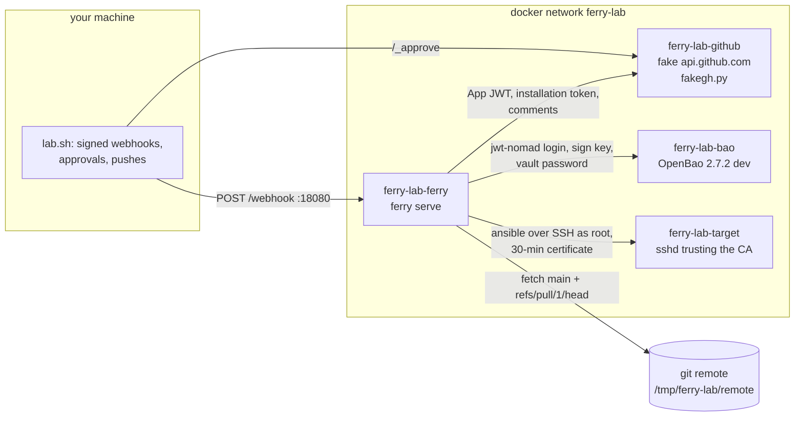

# ferry local lab: the full service loop, OpenBao and SSH certificates

One command stands up everything a production ferry deployment has, in Docker on one machine, so
you can replicate the setup, poke at it and change ferry based on what you find. It was built and
run from scratch on Nov 23, 2026; the walkthrough below is that run's output, trimmed.

Needs: Docker or rootless podman (see [below](#rootless-podman)), bash, git, curl, openssl. Nothing
is installed on the host; Python runs in the images.

```bash
deploy/local/up.sh        # ~15 s after the first image build; re-run to start from scratch
deploy/local/lab.sh open  # GitHub says: PR #1 opened by pip (who has write access)
deploy/local/lab.sh comments
deploy/local/down.sh      # stop; the lab dir (/tmp/ferry-lab, or $LAB_DIR) is kept for inspection
```

## Rootless podman

The scripts drive podman themselves when there's no Docker (`runtime.sh`; force it with
`LAB_RUNTIME=podman`). Two things differ from Docker, and the scripts handle both:

- **User namespaces.** Rootless podman maps container uids onto your subuid range, so a container
  can't write the bind-mounted lab dir, and you can't delete what it wrote. `podman-docker`, the
  `docker` the scripts use under podman, adds `--userns=keep-id` to `run -u $(id -u):$(id -g)` (you,
  inside and out) and `--userns=keep-id:uid=10001,gid=10001` to the service container (the image's
  `ferry` user is you on the host). The executor runs as 10002 with no keep-id: it only reads the
  work dir. `up.sh` wipes the lab dir with `podman unshare rm -rf`.
- **Containers belong to the shell that started them.** Plain `podman run` parents each container's
  conmon on your session. Where the whole process tree is killed when a command ends (some CI
  runners, agent sandboxes, `systemd-run --scope`), the containers die with it, while `podman ps`
  can still say "Up". Run a podman API service in a session that persists, and point the lab at
  it. The shim then uses `podman --remote`:

  ```bash
  podman system service --time=0 &          # or: systemctl --user enable --now podman.socket
  export CONTAINER_HOST=unix://$XDG_RUNTIME_DIR/podman/podman.sock
  deploy/local/up.sh
  ```

If podman panics about its pause process after an upgrade, run `podman system migrate` (repeat it
until it stops panicking). Checked with podman 5.7 (rootless, overlay): the full loop, `lab.sh
evil`/`leakcheck` ("0 of 3"), and `lab.sh replay` ("duplicate delivery").

## What's running



| Lab piece | What it stands in for in production |
|---|---|
| `ferry-lab-ferry` (this repo's `Dockerfile`) | The ferry Nomad job (`deploy/nomad/ferry.nomad.hcl` is the starting point; the real one lives in your infrastructure-as-code repo) |
| `fakegh.py` on :18999 | api.github.com plus the GitHub App. It answers `/app`, the installation token, PR, files, reviews, comments, collaborator permission, the branch's rulesets and the GraphQL review decision for PR #1. Writers: `james`, `pip`. |
| `/tmp/ferry-lab/remote/acme/ansible.git` with `refs/pull/1/head` | your config repo on GitHub (ferry fetches with `FERRY_GITHUB_GIT_URL=file:///remote`) |
| `ferry-lab-bao`, dev mode, root token `lab` | your OpenBao cluster |
| `ssh-client-signer/` mount, role `ferry`, policy `ssh-sign-ferry` (set by `up.sh` with the CLI) | your OpenBao config (terraform or CLI): the same values |
| `auth/jwt-nomad`, role `ferry`, static public key; `mkjwt.py` mints the token | Nomad workload identity: the job's `identity { aud = ["openbao.io"] file = true }`, validated against Nomad's JWKS, bound on `nomad_job_id = ferry` |
| `secret/ansible/vault-password` (dev kv-v2) | the vault password at the path you set in `FERRY_OPENBAO_VAULT_PASSWORD_PATH` (any kv-v2 mount) |
| `ferry-lab-target` (`target/Dockerfile`) | Every managed host once its sshd trusts the SSH user CA: `TrustedUserCAKeys`, and root accepts only principal `ferry`. No authorized_keys at all here, so any login is a certificate login. |
| `/tmp/ferry-lab/state/locks.db` | The ferry job's host volume (`FERRY_LOCK_DB`) |
| The config repo `up.sh` writes (one host, a `motd` role, one vaulted var) | your config repo with its `ferry.yaml` |

## The loop, step by step

Each `lab.sh` command delivers what GitHub would, then waits for ferry's job and prints `/healthz`.

1. **`lab.sh open`**: `pull_request.opened` by `pip`.
   - ferry verifies the HMAC and sees `pip` has write access, so it queues a plan.
   - The job fetches `main`, reads `ferry.yaml` from there, and fetches the PR at its exact head SHA.
   - It logs in to OpenBao with the JWT, generates a throwaway ed25519 key, gets a certificate (principal `ferry`, 30 minutes), and reads the vault password.
   - It runs `ansible-playbook --check --diff --limit target` over SSH as root, posts the plan comment as `ferry-lab[bot]`, and takes the lock.
   - **Check:** `lab.sh comments`, `lab.sh sshlog`, `lab.sh locks`.
     ```
     Accepted publickey for root ... ED25519-CERT ... ID jwt-nomad-global:default:ferry:ferry:ferry:openbao (serial ...)
     [('lab', 1, 'e39bc779...', 'pip', 1795475332.5)]
     ```
2. **`lab.sh apply`**: `/ferry apply` from `james`. It's refused: `needs 1 approval(s) from someone other than the author, has 0`.
3. **`lab.sh approve`, then `lab.sh apply`**: applied.
   - **Check:** `lab.sh motd` shows `motd: hello from the PR` and `vaulted secret: s3cret-from-vault`. The second line proves the vault password reached the job; the comment shows that task as `no_log` with details hidden.
4. **`lab.sh push "hello again"`**: a new commit on the PR branch, then `synchronize`. ferry plans the new head.
   - `lab.sh apply` is now refused, because james's approval was for the old head.
5. **`lab.sh open mallory`**: a PR event from a user without write access. ferry posts one "waiting for `/ferry plan`" comment and doesn't plan. `lab.sh plan mallory` is refused; `lab.sh plan` (james) plans.
6. **`lab.sh close`**: the lock is released (`lab.sh locks` returns `[]`).
7. **`lab.sh replay`**: re-sends the last delivery's exact signed body under a new `X-GitHub-Delivery`. ferry answers `duplicate delivery`, because it remembers body digests, not only ids. `curl -s localhost:18080/metrics` shows `ferry_webhook_rejected_total{reason="duplicate"} 1` next to the job counters, and `curl -s localhost:18080/jobs` shows the job history.

## Finding from the first run (fixed in this PR)

**SSH connection sharing leaked across jobs.** With Ansible's default ControlPath (`~/.ansible/cp`) and `ControlPersist`, the next job reused the previous job's still-open master connection. `sshlog` showed **one** certificate login for three jobs: jobs 2 and 3 ran under job 1's certificate after its credentials were deleted, and sshd's log attributed them wrongly. Now each job's ControlPath lives in its own temporary directory (`ANSIBLE_SSH_CONTROL_PATH_DIR`), and the check shows one login and one certificate serial per job:

```bash
docker logs ferry-lab-target 2>&1 | grep Accepted | sed -E 's/.*serial ([0-9]+).*/serial=\1/' | sort | uniq -c
```

## A hostile plan can't read the service's secrets

The playbooks run in a separate container, `ferry-lab-executor`: user `ferry-run`, none of the service's secrets mounted, the work dir read-only. See "Playbooks run apart from the service" in the top-level README.

- **`lab.sh evil`**: pushes a change that gets past the static policy. It uses file lookups plus a lookup plugin shipped in the repo, which runs on the controller during the *plan*. The plugin tries the App key, the webhook secret, the workload JWT and the lock file, dumps its environment and every `/proc/*/environ`, and copies everything to the target with the job's own certificate.
- **`lab.sh leakcheck`**: shows what it got, without printing any secret. Every service secret path is `DENIED (FileNotFoundError)`, the playbook ran as `uid=10002`, there's no `VAULT_TOKEN` and no service variable in its environment, and `service secrets found ...: 0 of 3`. It can read the job's own key and vault password. That's inherent: the playbook needs them. Checked Nov 24.

## Things worth trying (and what to look for)

- **Certificate limits:**
  ```bash
  ssh-keygen -q -t ed25519 -N '' -f /tmp/k
  docker exec -i -e BAO_ADDR=http://127.0.0.1:8200 -e BAO_TOKEN=lab ferry-lab-bao \
    bao write ssh-client-signer/sign/ferry public_key=- valid_principals=root < /tmp/k.pub
  # * root is not a valid value for valid_principals
  ```
  A `ttl` over 1 h and `permit-agent-forwarding` are rejected too.
- **Token scope:** log in as the job does, then try anything but its two permissions. It's denied.
  ```bash
  T=$(docker exec -e BAO_ADDR=http://127.0.0.1:8200 ferry-lab-bao sh -c \
    "bao write -field=token auth/jwt-nomad/login role=ferry jwt=$(cat /tmp/ferry-lab/jwt/nomad_openbao.jwt)")
  docker exec -e BAO_ADDR=http://127.0.0.1:8200 -e BAO_TOKEN=$T ferry-lab-bao bao kv get -mount=secret ansible/other    # permission denied
  docker exec -e BAO_ADDR=http://127.0.0.1:8200 -e BAO_TOKEN=$T ferry-lab-bao bao kv get -field=password -mount=secret ansible/vault-password  # lab-vault-pass
  ```
- **OpenBao down** (`docker stop ferry-lab-bao`), then `lab.sh plan`: ferry comments the error on the PR (`ferry couldn't finish: URLError ...`) and the service stays up (`/healthz`). Checked Nov 23.
- **The target refuses certificates** (`docker exec ferry-lab-target sh -c 'echo nobody > /etc/ssh/auth_principals/root'`), then `lab.sh open`: `❌ plan is not clean ... 1 unreachable`, so apply would be refused. Checked Nov 23.
- **Config comes from main:** change `ferry.yaml` on the PR branch (for example `apply: {min_approvals: 0}`), `lab.sh push`, then `lab.sh apply`. An approval is still required.
- **GitHub's own rules:** require two approvals on `main`, then approve once and apply. ferry refuses, naming the ruleset:
  ```
  curl -s localhost:18999/_rules -d '{"rules":[{"type":"pull_request","ruleset_id":1,"parameters":{"required_approving_review_count":2}}]}'
  ```
- **Duplicate deliveries and bad signatures:** re-send a body with the same `X-GitHub-Delivery`, or the same body under a new one (both: `duplicate delivery`), or with a wrong `X-Hub-Signature-256` (expect 401).
- **Drift:** add `-e FERRY_DRIFT_INTERVAL_HOURS=0.01` to the ferry container in `up.sh`. Drift runs on `main` and writes `ansible_drift.prom` on the target, if it has a textfile dir.

To change ferry and re-test: edit `src/ferry/...`, then `python -m pytest -q`, then `deploy/local/up.sh` (it rebuilds the image), then walk the loop. `lab.sh logs` shows ferry's log, including the full ansible output.

## Known gaps before production

- **Secret lookups that authenticate some other way** (e.g. a client certificate configured in `/etc/ansible/ansible.cfg` on an existing executor host). In ferry's job it must use the per-job token (`VAULT_TOKEN` / `ANSIBLE_HASHI_VAULT_TOKEN`, which ferry sets). The lab's config repo has no secret lookups, so it doesn't exercise this.
- **Host keys:** the image checks host keys (`ANSIBLE_HOST_KEY_CHECKING=True`). Mount a known_hosts file at `/etc/ssh/ssh_known_hosts` in the executor (or the service, without an executor): pinned keys, or `@cert-authority` lines if your hosts have OpenBao-signed host certificates. The lab turns checking off for its throwaway target (`up.sh`).
- **Webhook ingress:** expose only `POST /webhook`, restricted to GitHub's hook IP ranges (GitHub publishes them at `api.github.com/meta`).
- **One instance:** locks are one SQLite file, so run one ferry per config repo, as Atlantis does.

The shared executor socket and checkout work directory use native runtime volumes
(`ferry-lab-run`, `ferry-lab-work`). This avoids Docker Desktop bind-mount socket permissions
and deleted/recreated checkout path inode caching. `down.sh` removes both volumes.

## Operator runs through the same service

`up.sh` also builds `ferry-operator:lab` (the ferry image plus the OpenBao CLI) and provisions
OpenBao's **identity OIDC** endpoint, not another JWT auth mount:

- RS256 key `ferry`, role `ferry`, client/audience `ferry`, five-minute identity tokens;
- issuer `http://ferry-lab-bao:8200/v1/identity/oidc` (plain HTTP only in this isolated lab);
- entities `lab-demo` (allowed) and `lab-denied` (valid identity, not allowed by ferry);
- aliases on the `token/` mount, and token roles `ferry-operator` / `ferry-operator-denied`
  whose `allowed_entity_aliases` bind
  each demo login to its entity. The dev admin creates these logins; a real operator uses OIDC login.

The two login tokens live under `$LAB_DIR/operators/`, mode 0600. They can **only** request an
identity token from `identity/oidc/token/ferry`; they cannot sign SSH keys or read the vault password.
The service allows the demo **entity ID** via `FERRY_RUN_ALLOWED_SUBJECTS`, not its display name,
and uses an eight-second lease so the expiry demonstration takes seconds rather than minutes.

```bash
deploy/local/lab.sh close           # release any PR-held lock first
deploy/local/lab.sh run             # --check --diff by default
deploy/local/lab.sh run-apply       # explicit apply; then inspect `lab.sh motd`
deploy/local/lab.sh run-denied      # valid RS256 identity, unauthorized subject; must fail
deploy/local/lab.sh run-contention  # CLI lease refuses PR apply; PR lock refuses CLI
deploy/local/lab.sh run-expiry      # SIGKILL CLI; after 10s another CLI acquires and finishes
curl -s localhost:18080/jobs        # trigger=cli and subject, alongside webhook jobs
```

Contention and expiry close/reopen PR #1 and temporarily create `ferry-lab-operator`; they should
be run serially against a fresh, healthy lab (before hostile-playbook scenarios). The long-running
`slow.yml` is committed in the demo remote, so these tests do not bypass the clean-tree/remote-SHA
checks. Scenarios fail nonzero on an unexpected acceptance or missing expected refusal.

Each CLI runs in a disposable container as your host UID. It clones the config repo from a
read-only mounted remote; its `origin` is configured and its working tree is clean. The only login
mounted is the selected operator's token. **No service credentials, signing role, workload JWT,
state DB or executor socket are mounted.** SSH host checking is disabled only for the throwaway
lab target, matching the webhook lab. The CLI executes Ansible on the operator, not in the service.

The equivalent command inside that container is:

```bash
ferry run -i lab --service http://ferry-lab-ferry:8080 \
  --token-command 'bao read -field=token identity/oidc/token/ferry' site.yml
```

**OpenBao CLI detail:** OpenBao 2.7.2 generates identity tokens with `bao read` (HTTP GET).
`bao write -field=token identity/oidc/token/ferry` fails before making a request because there is
no data; forcing the write uses PUT, not the endpoint's GET. The lab therefore explicitly supplies
the supported `--token-command` rather than relying on a write-based default.

API clients send `Authorization: Bearer <identity-token>` and JSON to `POST /api/runs`:
`{inventory: "lab", limit: "target", mode: "check", sha: "<remote-commit>", public_key: "ssh-ed25519 ..."}`.
A successful response includes `run_id`, `certificate`, `vault_password`, `lease_expires_at`.
The same subject renews at `POST /api/runs/{run_id}/lease` and releases at
`POST /api/runs/{run_id}/finish` with `{ok, counts, changed_hosts}`. Never print the response's
credentials into shared logs. A held inventory returns 409, a valid but denied subject 403.
