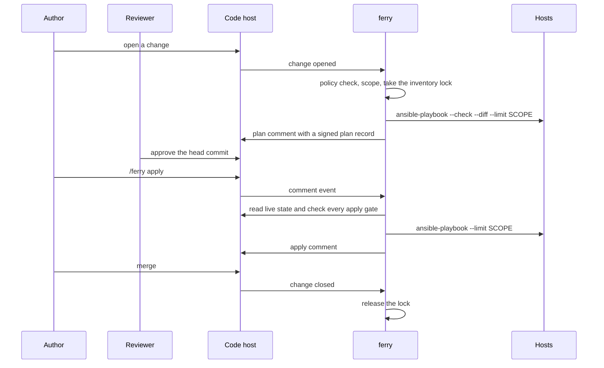
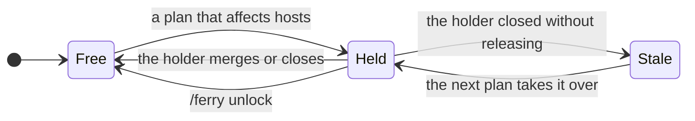

# Concepts

This page defines the terms the rest of the documentation uses, and describes what ferry checks
before it touches a host.

ferry's code and messages say "MR" (merge request) and "PR" (pull request) for the same thing.
These pages say "change" where the code host does not matter.

- [The flow](#the-flow)
- [Plan](#plan)
- [Apply gates](#apply-gates)
- [Locks](#locks)
- [Scope](#scope)
- [Drift](#drift)
- [Busy hosts](#busy-hosts)
- [Policy checks](#policy-checks)
- [Output redaction](#output-redaction)

## The flow



With the GitLab CI driver the steps are the same, but the plan and apply are CI jobs instead of
webhook events. See [Drivers](drivers.md).

## Plan

A plan is `ansible-playbook --check --diff --limit <scope>` run against the change's head commit.
ferry posts the result as a comment: per-host results, sanitized diffs, and a hidden **plan
record** (called the marker in the code).

The plan record holds the inventory, the commit, the `--limit`, whether the plan was clean, a
digest of `ferry.yaml`, and the time. Apply reads it back. It is trusted only when:

- it is the last line of a comment posted by ferry's own account, and
- under `ferry serve`, it carries a valid HMAC. The key is derived from the webhook secret, which
  neither a change nor a playbook can read.

Markers anywhere else, or in anyone else's comments, are ignored.

A plan is **clean** when Ansible exited normally and no host failed, was unreachable or was
[blocked](#busy-hosts).

Ansible has no plan file, so apply re-runs the playbook live with the same `--limit`. The apply
gates bound how far the hosts and the change can move in between.

Check mode is not a sandbox. A plan runs the change's own playbooks with real SSH access. See the
[security model](security.md#a-plan-runs-the-changes-code).

## Apply gates

Every gate is checked at apply time against the code host's live state. Under `ferry serve` the
gates run twice: once before any credential is minted, and again with the credentials in hand.

**The change**

- It is open, is not a draft, has no merge conflicts, and has no unresolved blocking discussions.
- The commit being applied is the change's current head.
- It targets the default branch, or a branch listed in `base_branches` in the default branch's
  `ferry.yaml`. A change retargeted after its plan is refused.
- It is up to date with its target branch (`apply.require_up_to_date`, on by default). Ansible
  applies whole roles, so a branch that predates a merged change would put hosts back to the older
  state. If the code host cannot say whether the branch is behind, the apply is refused.
- The code host reports it as mergeable. On GitHub, branch protection and rulesets must also allow
  the merge. See [Backends](backends.md#branch-protection-and-rulesets).

**The plan**

- The newest plan record for this inventory is for the head commit.
- It is clean (`apply.require_clean_plan`, on by default).
- It is younger than `apply.max_plan_age_hours` (24 by default).
- It was made under the same `ferry.yaml` (the config digest matches).
- The scope computed now equals the scope that was planned.
- No `/ferry unlock` came after it.
- The policy checks still pass.

**Approvals**

- At least `apply.min_approvals` approvals count (1 by default).
- An approval counts only if it is for the current head.
- It counts only from someone who could apply the change themselves: write access on GitHub,
  Developer or higher on GitLab. On a public repository anyone can leave an approving review.
- ferry's own account never counts.
- The author's approval does not count. Neither does one from anyone who authored, committed or
  pushed commits in the change. `apply.allow_author_approval: true` turns this off, for
  single-maintainer repositories.
- If the code host cannot say who pushed, no approval counts.

**The person applying**

- They have write access (Developer or higher on GitLab).
- If `apply.allowed_users` is set, they are in it. Being listed does not replace having access.

**The lock**

- The change holds the inventory lock, or the lock is free. See [Locks](#locks).

**Several inventories**

A bare apply (no inventory named) applies each inventory in `ferry.yaml` order and stops at the
first one that is refused or does not apply cleanly. The rest are reported as not run. With
`apply.require_inventory: true`, a bare apply is refused and each inventory must be named. An
inventory can override `allowed_users`, `min_approvals` and `run_allowed` for itself. See the
[configuration reference](configuration.md#inventories).

## Locks

There is one lock per inventory. A plan that affects hosts takes it, and the change holds it until
it merges or closes. While it is held, no other change can plan or apply that inventory, so two
changes cannot interleave on the same hosts.



While the lock is held, a request from anyone else is refused and the lock stays where it is.

**Where locks live**

| Driver | Store |
|---|---|
| `ferry serve` | A row in the service's SQLite state file (`FERRY_LOCK_DB`). Nothing is stored in the repository. |
| GitLab CI | An annotated tag `ferry-lock-<inventory>`. Tag creation is atomic on the server, and the tag message names the holder. |

**Stale locks.** When another change asks for a held lock, ferry checks whether the holder is still
open. A holder that is closed, merged or deleted (a definite 404 or 410) is stale, and the lock is
taken over. Any other error while checking (a timeout, a 5xx, a rate limit) keeps the lock and
refuses the request. Locks fail closed.

**`/ferry unlock`.** Under `ferry serve`, someone with write access can comment
`/ferry unlock [inventory]` on the change that holds a lock. The lock is released and the change's
plan stops counting: apply is refused until the change is planned again. On a change that holds no
lock, the command says so and changes nothing.

**Other holders.** Scheduled drift and [`ferry run`](run.md) take the same lock. A change cannot
take over a lock held by a run or by drift, and a run cannot take a lock held by a change.

**Losing the state file frees every lock.** Keep it on persistent storage and back it up. See
[Operations](operations.md#back-up-the-state-file).

## Scope

ferry maps the files a change touches to the hosts and groups they affect. The result becomes
`--limit`. Rules, first match wins per file:

| Changed file | Affects |
|---|---|
| Matches `scope.ignore` (docs, CI files, tests) | nothing |
| `<inventory>/host_vars/<host>` | that host |
| `<inventory>/group_vars/<group>` | that group (`all` means every host) |
| `roles/<role>/...` | the hosts of every play that uses the role, directly, through `include_role` or `import_role`, or through role dependencies |
| A playbook imported from the main playbook | that playbook's hosts (the main playbook itself means every host) |
| Anything else (inventory files, `ansible.cfg`, `requirements.yml`, `ferry.yaml`, plugins) | every host |

Scope over-approximates. A play with a complex host pattern (`a:&b`, `!c`, globs, templates)
widens to every host instead of risking a plan that covers less than the apply.

A change that affects no host gets a plan comment that says so. It takes no lock and applies as a
no-op.

To see what a set of files maps to:

```bash
ferry scope roles/chrony/tasks/main.yml inventory/host_vars/web1.yml
```

## Drift

A drift run is check mode over every host of an inventory at the default branch. ferry then writes
one file, `ansible_drift.prom`, into each host's node_exporter textfile directory. That is its only
write during a drift run. Unreachable and blocked hosts are skipped, so their file goes stale,
which is the signal that the check did not run there.

| Metric | Meaning |
|---|---|
| `ansible_drift_last_run_timestamp_seconds` | When the last drift check finished on this host |
| `ansible_drift_changed_tasks` | Tasks check mode says would change (0 means the host matches the default branch) |
| `ansible_drift_failed_tasks` | Tasks that failed during the check (the check itself is broken) |
| `ansible_drift_info{commit}` | The commit the host was compared against |

Every series carries an `inventory` label. The run also writes `drift.json` and `drift.prom`
locally, with all hosts in one file, for CI artifacts.

ferry alerts on drift. It does not remediate: there is no automatic apply of the default branch.

Under `ferry serve`, drift runs every `FERRY_DRIFT_INTERVAL_HOURS` and takes each inventory's lock
first. An inventory that is locked is skipped and recorded as such. Under CI, schedule
`ferry drift` on the default branch. Settings are in the
[configuration reference](configuration.md#drift).

## Busy hosts

Some hosts must not be touched at certain times. A guard task in your playbooks can refuse by
failing with a message that starts with `guard.busy_marker` (`FERRY_HOST_BUSY` by default):

```yaml
- name: Refuse while a job is running
  ansible.builtin.fail:
    msg: "FERRY_HOST_BUSY: job in progress"
  when: host_is_busy | bool
```

ferry reports that host as **blocked**, not failed:

- A plan with a blocked host is not clean, so it cannot be applied.
- An apply that meets a newly busy host leaves it alone and reports it blocked. The other hosts
  proceed.
- Drift does not write to a blocked host.

## Policy checks

`ferry policy` runs static checks over the playbooks and roles. Plan and apply run them first and
refuse if any fail:

- `check_mode: false` outside the paths in `policy.check_mode_false_allow`. Such tasks run for real
  during a plan.
- Any line matching `policy.deny_patterns`. The defaults deny `pipe` lookups and the `reboot`
  module.

The policy is a lint that makes honest mistakes loud. It is not a security boundary. A lookup
plugin shipped in the repository still runs on the controller during a plan.

## Output redaction

Everything ferry posts passes through a redactor:

- Results of `no_log` tasks arrive censored by Ansible. ferry also drops their diff and message.
- Diffs of files matching `redact.sensitive_paths` (shadow files, keys) are replaced by "changed".
- Values of credential-looking environment variables are masked, along with any listed in
  `redact.env_vars`.
- Built-in patterns mask PEM private keys, Vault, GitLab, Slack and AWS tokens, crypt hashes, and
  `password=...` style assignments. Add your own in `redact.patterns`.
- Under `ferry serve`, the job's own credentials and the vault password are masked too.

Redaction is a safety net. The contract is still: put `no_log: true` on any task that handles a
secret.
