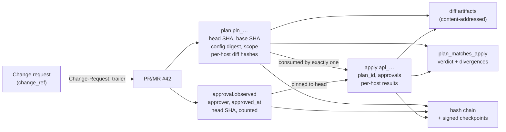

# RFC 0001: Audit trail and audit API

| | |
|---|---|
| Status | **Proposed.** Nothing in this document is implemented. |
| Applies to | `ferry serve` (in full), `ferry run` (through the service), the CI driver (in part, see [The CI driver](#the-ci-driver)) |
| API contract | [`docs/api/audit.openapi.yaml`](../api/audit.openapi.yaml) (OpenAPI 3.1) |

- [Summary](#summary)
- [What exists today](#what-exists-today)
- [Goals and non-goals](#goals-and-non-goals)
- [Design overview](#design-overview)
- [1. Event model](#1-event-model)
- [2. Proving that a change maps to a set of changes](#2-proving-that-a-change-maps-to-a-set-of-changes)
- [3. Change-request linkage, for humans and agents](#3-change-request-linkage-for-humans-and-agents)
- [4. Tamper evidence](#4-tamper-evidence)
- [5. Storage, export and retention](#5-storage-export-and-retention)
- [6. The API](#6-the-api)
- [7. The CLI](#7-the-cli)
- [8. Migration and compatibility](#8-migration-and-compatibility)
- [Threat model notes](#threat-model-notes)
- [Proposed settings](#proposed-settings)
- [Open questions](#open-questions)

## Summary

An auditor reviewing ferry should be able to start from a pull request or merge request, or from a
change-request id in a ticketing system, and get an answer to five questions without reading PR
comments or service logs:

1. **What was planned?** At which commit and under which rules, for which hosts, and with what
   predicted diff on each host.
2. **Who approved it?** For which commit, and did ferry count the approval?
3. **What was applied?** Which plan did it consume, and what changed on each host?
4. **Did the apply match the plan?** If it didn't, where did it diverge?
5. **Has this record been changed since it was written?**

This RFC proposes:

- an append-only, versioned **event log**, kept apart from the lock store;
- stable **`plan_id` and `apply_id`** values, and a rule that an apply references exactly one plan;
- per-host **diff hashes**, with the diffs themselves kept as content-addressed artifacts;
- a computed **`plan_matches_apply`** verdict;
- an optional **`change_ref`** that links a change to a change request, with a per-inventory
  policy to require one, and a recorded identity for agent-originated work;
- a **hash chain** with optional signed checkpoints, and `ferry audit verify`;
- an authenticated **read API** under `/api/v1`, and `ferry audit show | export | verify`.

`GET /jobs` stays as it is, and is deprecated.

## What exists today

What ferry 0.4.2 records:

| Where | What | Limits |
|---|---|---|
| `GET /jobs` (the `jobs` table in `FERRY_LOCK_DB`) | Action, change number, short SHA (12 characters), user, inventory, result, start, duration, trigger. CLI runs add subject, display name, run id, mode, limit, playbook, reason, certificate serial and task counts. | Unauthenticated. The newest `FERRY_JOB_HISTORY` rows only (default 200). No refusal reasons or error text, by design (invariant 20). |
| PR/MR comments | The rendered plan and apply, and the plan record (`<!-- ferry:plan {...} -->`, HMAC-signed under `ferry serve`) with SHA, limit, clean, config digest, counts and time | Editable and deletable on the code host. Truncated to `max_comment_chars`. Only the latest trusted plan matters to apply. |
| Commit statuses | `ferry/plan` and `ferry/apply` state per inventory | One state per commit and name. No history. |
| Service log | Job results, and one `cli run <event>:` line per CLI run event | Unstructured, and kept for as long as the log pipeline keeps it |

Gaps an auditor would find:

- No link from an apply to the plan it consumed, except that both name the same SHA.
- No record of which approvals ferry counted, or why it ignored the others.
- Refusals are recorded only as a result of `refused`, with no reasons.
- No per-host record of what changed, except the comment, which may be truncated.
- The config digest is 16 hex characters (64 bits), and the `ferry.yaml` it stands for is not kept.
- No change-request reference.
- No tamper evidence. The history shares a SQLite file with the locks and is capped at 200 rows.

## Goals and non-goals

**Goals**

- Answer the five questions in the [summary](#summary) from ferry's own records.
- Make editing, reordering or removing past records detectable, given one checkpoint held
  outside ferry.
- Let identities and free text be erased without breaking verification.
- Add no runtime dependencies (invariant 24). Everything here uses the standard library and
  `cryptography`.
- Keep every existing gate and invariant as it is. The audit log records decisions. It never makes
  them.

**Non-goals**

- **Proving that events are true.** The log proves that ferry recorded something and that the
  record hasn't changed since. A compromised service can record false events from then on. See the
  [threat model notes](#threat-model-notes).
- **Proving what an operator's machine did.** `ferry run` executes Ansible on the operator's
  machine. Its results are the client's assertions and are labelled as such.
- **A ticketing integration.** ferry records and checks the format of a `change_ref`. Whether the
  referenced change request exists, or is approved, is an [open question](#open-questions).
- **A UI.** The [open questions](#open-questions) list the options.

## Design overview



Each box above is an event, or a view computed from events. Every event is appended to one hash
chain. Plans and applies are views over their events, served by the API.

## 1. Event model

### The envelope

Every event has the same envelope. Type-specific fields go in `data`.

```json
{
  "schema": "ferry.audit/v1",
  "chain_id": "chn_01JDQ3V6Z1W8K2X9M4T5R7Y0BC",
  "seq": 1042,
  "id": "evt_01JDX8M2Q4K7N9P3R5T6V8W0YZ",
  "type": "apply.completed",
  "at": "2026-11-25T03:14:07.123Z",
  "ferry_version": "0.5.0",
  "change": {"backend": "github", "repository": "example/infra", "number": 42,
             "url": "https://github.example.com/example/infra/pull/42"},
  "change_ref": "CHG-1234",
  "inventory": "prod",
  "plan_id": "pln_01JDX7ZK3A9B8C7D6E5F4G3H2J",
  "apply_id": "apl_01JDX8KQ5M4N3P2Q1R0S9T8V7W",
  "run_id": null,
  "actor": {"id": "act_01JDQ40W2E4R6T8Y0V2J406P8A", "kind": "human", "via": "comment"},
  "data": {},
  "prev_hash": "sha256:6f1c…",
  "hash": "sha256:9b2e…"
}
```

| Field | Meaning |
|---|---|
| `schema` | The envelope version. Changes within `ferry.audit/v1` only add optional fields. Readers ignore fields they don't know. A change that removes or redefines a field is a new schema version. |
| `chain_id` | Random, fixed when the audit store is created. Stops events being spliced in from another deployment's log. |
| `seq` | Position in the chain, from 1 with no gaps. Ordering is by `seq`, not `at`. |
| `id` | `evt_` and a ULID: unique, and sorts by time. |
| `at` | The service clock, in UTC, with milliseconds. Informational. |
| `change` | The PR or MR, if the event concerns one. Full 40-character SHAs appear in `data`. |
| `change_ref` | The change request, if one is known. See [section 3](#3-change-request-linkage-for-humans-and-agents). |
| `plan_id`, `apply_id`, `run_id` | Correlation ids, where they apply. `run_id` is the existing `ferry run` id (32 hex characters). |
| `actor` | Who caused the event, as a pseudonymous `act_` id plus kind and channel. The identity itself is held outside the chain, so it can be erased. See [PII](#pii-and-redaction). |
| `prev_hash`, `hash` | The chain. See [section 4](#4-tamper-evidence). |

`actor.kind` is `human`, `agent`, `service` (ferry itself, for example the drift schedule) or
`unknown` (an unauthenticated webhook). `actor.via` is `comment`, `review`, `push`, `webhook`,
`cli`, `schedule` or `service`. An agent acting for a person also carries `on_behalf_of`, another
actor reference.

### Event types

All ids are ULIDs with a type prefix: `pln_`, `apl_`, `evt_`, `act_`, `chn_`, `ckp_`. The
OpenAPI file has the full schema for every `data` object. The table lists the fields that matter
for audit.

| Type | Written when | Key `data` fields |
|---|---|---|
| `audit.genesis` | The audit store is created | `chain_id`, ferry version, whether signing is configured |
| `service.started` | `ferry serve` starts | ferry version, backend, default branch, signing key id, non-secret settings that affect gates |
| `switch.changed` | ferry notices a switch flip | switch (`applies`, `plans`), new state |
| `webhook.received` | An authenticated delivery is accepted | delivery id, event kind, head SHA, the command parsed, `outcome` (`queued`, `ignored`, `duplicate`) |
| `webhook.rejected` | ferry refuses a delivery or a command | `reason`, from the fixed set of the `ferry_webhook_rejected_total` metric (`bad_auth`, `duplicate`, `stale`, `future`, `undated`, `bad_json`, `foreign_repo`, `no_access`, `head_moved`, `disabled`, `queue_full`, `too_large`, `bad_request`). It has an actor only when the delivery was authenticated. `suppressed` is the number of rejections with that reason left out since the last one recorded. Sampled: see below. |
| `plan.requested` | A plan is queued: an automatic plan (opened, reopened, pushed, ready for review) or `/ferry plan` | `plan_id`, head SHA, the comment id that asked for it, `trigger` (`autoplan` or `comment`) |
| `plan.refused` | A plan gate refuses | `plan_id`, `reasons[]` (as posted on the change, after the redactor) |
| `plan.started` | Gates passed and the lock is held, before credentials are minted | `plan_id`, head and base SHA, full config digest, scope (`limit`, `everything`, `noop`, file-to-host reasons), policy result |
| `plan.completed` | Ansible finished | `plan_id`, `clean`, `rc`, totals, `hosts[]` (see [per-host results](#per-host-results)), the plan record's MAC, and the comment's URL |
| `approval.observed` | Each time apply gates are evaluated | approver, `approved_at`, the head the approval is for and how ferry knows, `counted`, `reason` |
| `apply.requested` | `/ferry apply` is queued | `apply_id`, head SHA, the comment id |
| `apply.refused` | An apply gate refuses, before or after credentials | `apply_id`, `plan_id` (if a plan was found), `reasons[]`, `stage` (`precheck`, `recheck`) |
| `apply.started` | All gates passed, before credentials are minted | `apply_id`, `plan_id`, head SHA, the approvals that counted (event ids), `change_ref` |
| `apply.completed` | Ansible finished | `apply_id`, `plan_id`, `clean`, `rc`, totals, `hosts[]`, `verdict` |
| `lock.acquired` | A lock is taken | inventory, holder kind (`change`, `run`, `drift`), holder id |
| `lock.released` | A lock is let go | `reason` (`merged`, `closed`, `unlock_command`, `run_finished`, `run_expired`, `drift_finished`) |
| `lock.taken_over` | A stale holder is replaced | previous holder, `stale_because` (`closed`, `merged`, `not_found`, `gone`) |
| `drift.completed` | A drift run finishes | main SHA, config digest, `hosts[]`, the list of drifted hosts |
| `run.refused` | `POST /api/runs` refuses a verified identity | status, a short error code, the requested inventory, mode and SHA |
| `run.issued` | A CLI certificate is issued | `run_id`, mode, SHA, limit, playbook, `reason`, `intent`, `change_ref`, certificate serial and expiry |
| `run.finished` | The client calls `finish` | `run_id`, `ok`, counts, with `asserted_by_client: true` |
| `run.expired` | A lease runs out | `run_id`, last lease time |
| `audit.checkpoint` | A checkpoint is cut | `checkpoint_id`, the `seq` and `hash` it covers, `key_id` |
| `audit.redacted` | Identities or text are erased | the actor ids or commitments removed, and who asked (as an actor id) |
| `audit.pruned` | Old events are removed locally | the new first `seq`, and the checkpoint that anchors it |

`requested`, `started` and `completed` are separate because each can be the last event for a job:
a plan can be queued and never run (the queue is full, or the change was closed), or start and
never finish (the service crashed). A plan with `plan.started` and no `plan.completed` shows up as
`status: interrupted` in the API.

`approval.observed` is written every time the gates are evaluated (the precheck before credentials
and the recheck after each write one), not when the approval happens.
ferry doesn't receive approvals as events on every backend, and the gate re-reads live state at
apply time (invariant 5). The audit records what the gate saw.

**Rejected webhooks are sampled.** Many are unauthenticated, so anyone who can reach `/webhook`
could otherwise fill the log. Proposed: at most `FERRY_AUDIT_REJECT_SAMPLE` events per reason per
minute (default 10). The next recorded event carries `suppressed`, the number left out. The
existing `ferry_webhook_rejected_total` metric still counts every one.

### Per-host results

`plan.completed`, `apply.completed` and `drift.completed` carry one entry per host:

```json
{
  "host": "web-1.example.com",
  "state": "changed",
  "ok_tasks": 41, "changed_tasks": 2, "failed_tasks": 0, "skipped_tasks": 3,
  "unreachable": false, "blocked_reason": null,
  "changes": [
    {"key": "nginx/Install site config#1", "status": "changed",
     "diff_hash": "sha256:4be1…", "no_log": false}
  ],
  "diff_hash": "sha256:a91f…",
  "artifact": {"sha256": "a91f…", "bytes": 1832, "stored": true}
}
```

- **`changes[].key`** identifies a task: role, task name and the occurrence number of that name on
  that host. Ansible has no stable task id. A task renamed between plan and apply is a different
  task, and the verdict says so.
- **`changes[].diff_hash`** is the SHA-256 of the canonical JSON of that task's redacted result:
  status, the diffs after the redactor, and `no_log`. `no_log` results are already censored by
  Ansible and dropped by ferry's callback, so their hash covers only the status.
- **`diff_hash`** is the SHA-256 of the canonical JSON of the host's `changes` list, in run order.
- **`artifact`** is the redacted per-host result, stored by its hash if storing diffs is enabled.
  Anyone holding the artifact can recompute both hashes. Storing an artifact is not what makes the
  hash trustworthy: the hash is in the chain either way.

Hashes cover the redacted text, not the raw output, so that a hash never confirms a guess about a
secret that the redactor masked. The redactor's patterns come from `ferry.yaml`, which the config
digest covers, and every masked value becomes the same mask string. A plan and its apply
therefore redact the same way, even though each job has its own credentials.

## 2. Proving that a change maps to a set of changes

### One plan, one apply

- A plan is identified by `plan_id`, created at `plan.requested`.
- The plan record in the PR comment gains a `plan_id` field. It is covered by the existing HMAC, so
  the comment can't be edited to point at another plan.
- When apply accepts a plan record (invariants 7 and 8, unchanged), it writes the record's
  `plan_id` into `apply.started`. An apply references exactly one plan.
- A plan can be consumed by more than one apply. A retry after a failed apply re-uses the plan if
  the gates still pass. Each apply has its own `apply_id`, and the plan view lists every apply that
  consumed it.

### What a plan pins

| Pinned | From | Why it matters |
|---|---|---|
| Head SHA (40 characters) | The change, at the commented commit | The code that ran |
| Base SHA | The change's base at plan time | What "not behind" was checked against |
| Config digest | The full SHA-256 of the parsed `ferry.yaml` (`Config.digest()` keeps its first 16 characters, and the plan record carries those) | The rules that applied. An artifact holds the `ferry.yaml` text and the exact JSON the digest is computed over, so an auditor can recompute it. |
| Scope | `limit`, `everything`, `noop`, and why each file widened it | The hosts in play |
| Policy result | Passed, or the violations | What the lint saw |
| Per-host diff hashes | The run | What Ansible predicted for each host |
| `change_ref` | The description at plan time | The change request the plan was made for |

### The verdict: `plan_matches_apply`

Ansible has no plan file. Apply runs the playbook again, live, at the same SHA and with the same
`--limit`, and ferry already refuses an apply whose SHA, config or scope differs from the plan's.
The verdict covers the remaining gap, between what check mode predicted and what the real run did.

ferry computes it at `apply.completed`, from the plan's `hosts[]` and the apply's `hosts[]`:

| Divergence `kind` | Meaning |
|---|---|
| `host_unplanned` | The apply touched a host the plan didn't list, for example because dynamic inventory changed |
| `host_not_applied` | A planned host was not in the apply |
| `task_unplanned` | A task changed in the apply but was not predicted to |
| `task_not_applied` | A predicted change did not happen |
| `diff_mismatch` | The same task changed in both, with different redacted diffs |
| `check_mode_skipped` | The task was skipped in check mode (for example `command` without `creates`), so the plan could not predict it. Informational. |
| `host_failed` | The host failed, was unreachable, or was blocked during the apply |

The verdict is one of:

| `result` | When |
|---|---|
| `match` | No divergences, or only `check_mode_skipped` |
| `diverged` | At least one divergence other than `check_mode_skipped` and `host_failed` |
| `incomplete` | Only `host_failed` divergences: the apply didn't finish on some hosts |
| `unverifiable` | The plan has no per-host data. That covers plans made before upgrading, plans whose events were pruned, and every `ferry run`, where no plan exists and the results are the client's own. |

```json
"verdict": {
  "algorithm": "ferry.verdict/v1",
  "result": "diverged",
  "divergences": [
    {"host": "web-2.example.com", "kind": "diff_mismatch", "task": "nginx/Install site config#1",
     "planned_hash": "sha256:4be1…", "applied_hash": "sha256:07c3…"}
  ]
}
```

A divergence is not proof of a problem. A host can change between plan and apply, and check mode
can't predict everything. The verdict is evidence for a reviewer, not a gate. Whether a `diverged`
verdict should turn `ferry/apply` red is an [open question](#open-questions).

### Approvals pinned to a head

`approval.observed` records what the gate saw for each approver:

```json
{
  "approver": "act_01JDQ41…",
  "approved_at": "2026-11-25T02:58:11Z",
  "head_sha": "5f0c2a1e…",
  "head_source": "review_commit",
  "counted": false,
  "reason": "contributor"
}
```

| `head_source` | Backend | How ferry knows the approval is for this head |
|---|---|---|
| `review_commit` | GitHub | The review's `commit_id` |
| `approved_at_after_head` | GitLab with `approved_at` | The approval came after the head arrived |
| `reset_on_push` | GitLab without `approved_at` | The project removes approvals on push |
| `unknown` | GitLab, neither | Nothing counts (an existing fail-closed rule) |

`reason` is one of `counted`, `not_head`, `author`, `contributor`, `no_write_access`, `bot`,
`contributors_unknown` or `head_unknown`. These mirror the branches in `Engine.apply_checks`.
Recording them needs `VCSBackend.approvers` to return approval records (user, time, commit) rather
than names. That is an interface change in both backends, but adds no new API calls.

`apply.started` lists the `approval.observed` event ids that counted. An auditor can therefore
check that the approvals covered the exact head the apply ran.

## 3. Change-request linkage, for humans and agents

### Where `change_ref` comes from

| Path | Source |
|---|---|
| PR/MR | A `Change-Request:` trailer in the description's last paragraph (git trailer syntax, key case-insensitive), for example `Change-Request: CHG-1234` or `Change-Request: https://tickets.example.com/CHG-1234` |
| `ferry run` | `ferry run --change CHG-1234 …`, sent as `change_ref` in `POST /api/runs` |
| Drift | None. A drift run isn't a change. |

Values are at most 256 characters, with no control characters. A URL must be `https`. More than
one distinct `Change-Request:` trailer is ambiguous and counts as none.

The description can be edited by anyone with write access. A `change_ref` is therefore what the
change claims, not a verified link. **The plan pins it.** `plan.started` records the `change_ref`
it saw, and the plan record carries it. If the description later names a different reference,
apply refuses: "the change request changed since the plan: re-run the plan". This is the same rule
as for the SHA and the config.

### Requiring one

```yaml
apply:
  require_change_ref: false        # default
  change_ref_pattern: ""           # optional regex the whole value must match
inventories:
  - name: prod
    path: inventories/prod
    apply:
      require_change_ref: true
      change_ref_pattern: '^(CHG-[0-9]+|https://tickets\.example\.com/CHG-[0-9]+)$'
```

With `require_change_ref`, a plan without a `change_ref` still runs, with a warning in its comment.
The apply is refused: "`prod` requires a change request: add a `Change-Request:` trailer to the
description and re-run the plan". `ferry run --apply` against that inventory is refused with
400 `change_ref_required`. Check-mode runs are not affected.

Both keys are new `ferry.yaml` keys. The config digest changes when the implementation ships, and
that invalidates open plans (invariant 25). The changelog entry for the implementation has to say
so.

### Agent-originated changes

An agent reaches ferry by one of two routes, and the evidence differs.

**1. The agent opens a PR.** The code host authenticates the agent's account, for example a GitHub
App (`example-agent[bot]`) or a GitLab bot user. ferry records that account as an actor with
`kind: agent`, detected from the backend's user type. Who asked the agent, and why, can only come
from the PR itself, so ferry reads two more optional trailers and labels them `claimed`:

```text
Change-Request: CHG-1234
Requested-By: alice@example.com
Agent-Run: https://agents.example.com/runs/7f3c
```

These are assertions by the agent's account. They are as reliable as that account. The strong
link is the other direction: the change-request system records that it asked an agent to open PR
#42. An auditor then checks ticket → PR → ferry plan → ferry apply. The agent's PR still needs an
approval from a person who didn't contribute to it. The approval gate is unchanged, and an agent
account that pushed to the change is a contributor.

**2. The agent calls `ferry run`.** The identity token is verified, so the identity claims are
evidence, not assertions. ferry records:

- `sub` as the actor;
- the token's `act` claim, if present ([RFC 8693](https://www.rfc-editor.org/rfc/rfc8693#section-4.1)
  delegation: `sub` is the person, `act.sub` the agent acting for them), with the actor
  `kind: agent` and `on_behalf_of` set to the person;
- the request's existing `reason` (256 characters), a new `intent` (up to 1024 characters: what
  the agent was asked to do) and `intent_ref` (an `https` URL to the agent's run or prompt record).

```json
"actor": {
  "id": "act_01JDQ4A…", "kind": "agent", "via": "cli",
  "on_behalf_of": {"id": "act_01JDQ41…", "kind": "human", "via": "cli"}
}
```

Today, `run_allowed` and `FERRY_RUN_ALLOWED_SUBJECTS` check `sub` and `groups` only. A token that
carries `act` is accepted as if `sub` had run it. Recording `act` changes nothing about
authorization. Whether delegated tokens should need their own allowlist is an
[open question](#open-questions).

## 4. Tamper evidence

### The hash chain

```text
hash = "sha256:" + hex(SHA-256(canonical(event without "hash")))
```

- `canonical` is JSON with keys sorted, no insignificant whitespace, UTF-8 and no escaping beyond
  what JSON requires. In Python that is `json.dumps(e, sort_keys=True, separators=(",", ":"),
  ensure_ascii=False)`. Events contain no floating-point numbers: times are RFC 3339 strings and
  durations are integer milliseconds. Keys are ASCII. For these values the output is identical to
  [RFC 8785](https://www.rfc-editor.org/rfc/rfc8785) (JCS), so other languages can verify with a
  JCS library.
- `prev_hash` is the previous event's `hash`. The genesis event has 64 zeros.
- Events are appended in one `BEGIN IMMEDIATE` transaction that reads the current head and writes
  the next `seq`. SQLite triggers refuse `UPDATE` and `DELETE` on the events table. The triggers
  stop mistakes, not an attacker: the chain is what detects tampering.

### Commitments, so content can be erased

Identities and free text (`reason`, `intent`, refusal reasons that name a person) are not stored
in the event. The event holds a commitment, and the content lives in a side table:

```json
"reason": {"commitment": "sha256:1d9a…", "redacted": false}
```

`commitment = SHA-256(salt ‖ UTF-8(text))`, where `salt` is 16 random bytes kept with the text.
Erasing the text and its salt leaves the chain verifiable, and the salt stops anyone confirming a
guess at the erased value. Actors work the same way: `act_` ids are random and assigned on first
sight. The mapping to a login or subject lives in the `actors` table, outside the chain.

### Checkpoints

Every `FERRY_AUDIT_CHECKPOINT_EVERY` events (default 1000) or `FERRY_AUDIT_CHECKPOINT_INTERVAL`
(default 1h), whichever comes first, and only if there is a new event, ferry writes a checkpoint:

```json
{
  "schema": "ferry.audit.checkpoint/v1",
  "checkpoint_id": "ckp_01JDX9…",
  "chain_id": "chn_01JDQ3V6Z1W8K2X9M4T5R7Y0BC",
  "seq": 2000,
  "hash": "sha256:9b2e…",
  "at": "2026-11-25T04:00:00.000Z",
  "previous_checkpoint_id": "ckp_01JDX1…",
  "key_id": "ed25519:3a7f9c0e",
  "signature": "base64…"
}
```

- With `FERRY_AUDIT_SIGNING_KEY` set (an Ed25519 private key in PEM, a file only the service can
  read), `signature` is Ed25519 over the canonical JSON of the checkpoint without `signature`.
  `key_id` is the first 8 bytes of the SHA-256 of the raw public key, in hex.
- Without a key, the checkpoint is unsigned (`key_id: null`). It is still useful if it is copied
  somewhere ferry can't write, because it fixes the chain's head at that time.
- Each checkpoint is also an `audit.checkpoint` event, so checkpoints are in the chain too.
- Checkpoints go to the export sinks as they are cut (see [section 5](#5-storage-export-and-retention)).
  **An external copy of a checkpoint is what makes the chain worth checking.** Someone who can
  rewrite the database can rewrite the whole chain, unless an earlier checkpoint exists elsewhere.

### `ferry audit verify`

```text
ferry audit verify [--service URL | --file events.jsonl] [--checkpoint cp.json ...]
                   [--public-key key.pem] [--from-seq N] [--artifacts DIR]
```

1. Read events in `seq` order, from the service (`GET /api/v1/events?order=seq`) or from an export.
2. Check that `seq` has no gaps, that `chain_id` doesn't change, that each `prev_hash` is the
   previous `hash`, and recompute each `hash`.
3. Check every `audit.checkpoint` event, and every checkpoint given with `--checkpoint`: the event
   at its `seq` has its `hash`, and its signature verifies under the public key. Without
   `--public-key`, use `GET /api/v1/audit/keys`. An auditor should pin the key instead, because a
   compromised server serves its own key.
4. For every commitment whose content is present, recompute it. Report erased content as
   `redacted`, not as a failure.
5. With `--artifacts`, recompute every artifact's hash and each per-host `diff_hash`.
6. Recompute every `verdict` from the plan and apply events, and compare it with the recorded one.

The output is a short report and an exit status: 0 when everything is verified, 1 when there is a
mismatch (with the first bad `seq`), 2 when verification couldn't run. `--json` gives the report
in machine-readable form.

The server doesn't verify itself. There is no "verify" endpoint that returns `ok`, because the
answer would come from the party being checked. The API serves the material, and the verifier
runs elsewhere.

## 5. Storage, export and retention

### Storage

- **A separate SQLite file**, `FERRY_AUDIT_DB`. The default is `audit.db` next to
  `FERRY_LOCK_DB`. Losing the lock file frees the locks and keeps the audit. A lock-file
  migration or repair never touches the audit.
- Tables: `events` (append-only, with indexes on `type`, `inventory`, `change_number`,
  `change_ref`, `plan_id`, `apply_id`, `run_id`, `actor_id` and `at`), `checkpoints`, `actors`
  (`act_` id → kind, issuer, subject or login, display name, first and last seen), `texts`
  (commitment → salt, text), `meta` (chain id, schema version).
- **Artifacts** are files under `FERRY_AUDIT_ARTIFACTS_DIR` named by their SHA-256, written once.
  They hold per-host redacted results and the `ferry.yaml` text for each config digest. At most
  `FERRY_AUDIT_MAX_ARTIFACT_BYTES` (default 1 MiB) per host per run. A larger result keeps its
  hash, and the artifact is stored cut, marked `truncated`.
- **No row cap.** Size is managed by retention. A rough guide is 1 to 2 KB per event, so a busy
  repository with 1000 events a day grows by under 1 GB a year before artifacts.
- **Writes fail closed before credentials.** `plan.started`, `apply.started` and `run.issued` are
  written before ferry mints credentials. If the write fails, the job is refused. This extends the
  rule `ferry run` already follows for its issuance record. Events written after a run
  (`*.completed`) can't undo the run. If one fails, ferry spools it to `audit.spool.jsonl` next to
  the database, reports `"audit": "degraded"` in `/healthz`, and refuses new plans and applies
  until the spool has been appended to the chain.

### Export

There are no object-storage client libraries (invariant 24), so the design uses two sinks that
need none:

| Sink | How |
|---|---|
| A JSONL file | `FERRY_AUDIT_EXPORT_FILE`: every event and checkpoint, one per line, appended as written. A log shipper (Vector, Fluent Bit, Promtail, the Grafana agent) tails it into the log pipeline or object storage. |
| `ferry audit export` | Events from a `seq` or time range to stdout or a file, for batch upload: `ferry audit export --since 2026-11-01 \| aws s3 cp - s3://audit-example/ferry/2026-11.jsonl` |

Exported events include identities and text only with `--include-identities`, or with
`FERRY_AUDIT_EXPORT_IDENTITIES=true` for the file sink. The default export holds actor ids and
commitments only. It verifies the same way, and can be stored where fewer people can read it.

For audit, ship the file sink to storage with object lock (write-once) and keep it there for the
period your audit regime requires. The local database is the working copy. The export is the
record.

### Retention

| Setting | Default | Effect |
|---|---|---|
| `FERRY_AUDIT_RETENTION_DAYS` | `0` (keep everything) | Events older than this are removed locally, but only up to a checkpoint. The oldest kept event follows a checkpoint, and an `audit.pruned` event names the checkpoint that now anchors the chain. Verification starts from there. |
| `FERRY_AUDIT_ARTIFACT_RETENTION_DAYS` | `90` | Artifacts older than this are deleted. Their hashes stay in the chain, and the API answers 410 for them. |
| `FERRY_AUDIT_IDENTITY_RETENTION_DAYS` | `0` (keep) | Actor mappings and texts not seen for this long are erased, as by `ferry audit redact`. |

### PII and redaction

| Data | PII? | Where it lives |
|---|---|---|
| Code host login, OIDC subject, display name, the claimed `Requested-By` | Yes | `actors`, outside the chain |
| `reason`, `intent`, free-text refusal reasons | Possibly | `texts`, behind a commitment |
| Hostnames, inventory names, task names, redacted diffs | Not personal, but internal | Events and artifacts. Readable only through the authenticated API. |
| Source IP of a webhook | Yes | Not stored |
| Certificate serial, run id, delivery id | No | Events |

`ferry audit redact --actor act_… | --text sha256:… --reason "…"` erases the mapping or text, and
appends `audit.redacted`. It runs against the database file, not the API, because erasure is an
operator action on the service's storage. Exports that already contain identities have to be
handled where they are stored. That is one reason the default export leaves identities out.

## 6. The API

The full contract is [`docs/api/audit.openapi.yaml`](../api/audit.openapi.yaml). A summary:

| Method and path | Returns |
|---|---|
| `GET /api/v1/changes/{number}` | Everything about one PR or MR: its plans, approvals as last observed, applies, verdicts, locks, `change_ref`, and links to its events |
| `GET /api/v1/plans/{plan_id}` | A plan: what it pinned, its per-host results and artifact links, its status (`requested`, `refused`, `running`, `interrupted`, `completed`), and the applies that consumed it |
| `GET /api/v1/applies/{apply_id}` | An apply: its plan, the approvals that counted, the gates, per-host results, and the verdict |
| `GET /api/v1/runs/{run_id}` | A `ferry run`: identity, intent, certificate serial, and lease and finish events |
| `GET /api/v1/events` | Events, filtered by `since`, `until`, `inventory`, `change`, `change_ref`, `type`, `actor`, `plan_id`, `apply_id`, `run_id` and `after_seq`, with cursor pagination |
| `GET /api/v1/inventories/{name}/history` | One inventory's plans, applies, drift runs, CLI runs and lock changes, newest first |
| `GET /api/v1/artifacts/{sha256}` | One diff artifact, or 410 if it was removed by retention |
| `GET /api/v1/audit/checkpoint` | The latest checkpoint, or the one at `?seq=` |
| `GET /api/v1/audit/keys` | Checkpoint public keys, current and retired |

**Authentication** reuses the `ferry run` identity: a bearer JWT from `FERRY_RUN_OIDC_ISSUER`
for `FERRY_RUN_OIDC_AUDIENCE`, checked by the same verifier. **Authorization** is a separate read
role: `FERRY_AUDIT_READ_SUBJECTS` and `FERRY_AUDIT_READ_GROUPS`. Being allowed to run doesn't let
you read the audit, and being allowed to read doesn't let you run. The API answers 404 unless the
issuer, audience and at least one read entry are set, as the run API does.

**Errors** use the same shape as the run API, `{"error": "short text"}`, plus a fixed `code`. As
invariant 22 requires, error text is short and never echoes upstream bodies.

**Pagination:** `limit` (1 to 500, default 100) and an opaque `cursor`. `next_cursor` is `null`
on the last page. Cursors are stable under appends, because they encode a `seq`.

**Identities in responses:** actors are returned with their login or subject, unless erased
(`redacted: true`). A tier that sees only pseudonyms is an [open question](#open-questions).

**`GET /jobs`** is unchanged: unauthenticated, bounded, and summary only. It gains a
`Deprecation: true` header and a `Link` to `/api/v1/events`. It is removed no earlier than 1.0.

**Routing:** `/api/v1/*` is authenticated, but it serves hostnames, diffs and identities. Keep it
on the internal network, like `/jobs`. If it has to be reachable from outside, allow `GET
/api/v1/*` only, and only from where the auditors are.

## 7. The CLI

The commands that talk to the service use the same identity token command and service URL as
`ferry run` (`--token-command` or `FERRY_RUN_TOKEN_COMMAND`, `--service` or `FERRY_SERVICE_URL`).

```text
ferry audit show <change | plan_id | apply_id | run_id | change_ref> [--json]
```

A readable history of one change: plans with their pinned SHA, config digest and per-host
summary; approvals and whether each counted; applies with their plan id and verdict; lock events.
A change is given as `42`, `#42` or `!42`. `--change-ref CHG-1234` lists every change and run that
names that reference.

```text
ferry audit export [--since T] [--until T] [--after-seq N] [--inventory I] [--type T ...]
                   [--include-identities] [--output FILE]
```

JSONL on stdout, in `seq` order. With no filter, the export is a complete, verifiable segment of
the chain. With filters, it is a report and doesn't verify on its own. The command says so on
stderr.

```text
ferry audit verify  (see section 4)
ferry audit redact  (local only, see section 5)
```

## 8. Migration and compatibility

| Area | Effect |
|---|---|
| Upgrade | The audit store is created on first start, with `audit.genesis`. No backfill: the old job history has no evidence to import. It stays readable at `/jobs`. |
| Plan records | Gain `plan_id`, `change_ref` and the base SHA. Old records still pass the apply gate. An apply that consumes one records `plan_id: null`, and its verdict is `unverifiable`. Old plans expire after `max_plan_age_hours`, 24 hours by default. |
| Config digest | The audit stores the full SHA-256. The plan record keeps the 16-character prefix, so this alone invalidates no plans. The new `ferry.yaml` keys do change the digest, as noted in [section 3](#requiring-one). |
| `VCSBackend.approvers` | Returns approval records instead of names, in both backends. Internal only. |
| The callback plugin | Records per-task results for tasks skipped in check mode, which the `check_mode_skipped` divergence needs |
| `POST /api/runs` | Accepts `change_ref`, `intent` and `intent_ref`. Older clients don't send them. Older services ignore fields they don't know, so a new service echoes the recorded `change_ref` in its 201 response. If the client sent `--change` and the echo is missing, `ferry run` stops before using the certificate, finishes the run as failed, and says the service is too old. |
| `/jobs`, `/healthz`, `/metrics` | Unchanged, apart from the `Deprecation` header and an `audit` field in `/healthz` (`ok` or `degraded`, a fixed value, so invariant 20 still holds in spirit; it is a new field, so it needs a maintainer's yes) |
| Lock store | Unchanged |
| Rollback | Downgrading leaves `audit.db` alone. Upgrading again continues the chain. Plan records with the new fields are still accepted by the older version, since its HMAC covers every field. |

### The CI driver

The GitLab CI driver has no storage of its own. Proposed: it writes the same events, as a chain of
one job, to `ferry-audit.jsonl` in the job's artifacts, and `ferry audit verify --file` can check
them. Without a service there are no checkpoints held outside the job, and the job can edit its
own artifacts. That makes this a convenience for the CI driver, not tamper evidence. For an
auditable trail, run `ferry serve`. [security.md](../security.md) already recommends it for
teams.

## Threat model notes

**What the trail proves.** Given a chain that verifies against a checkpoint held outside ferry,
the events up to that checkpoint have not been edited, reordered, inserted or removed since it was
cut. With a signature, the checkpoint came from a holder of the signing key.

**What it doesn't prove.**

- **That events are true.** ferry is the trusted party, as it already is for the gates. An
  attacker who controls the service can write false events from then on. External, write-once
  copies of the export limit them to the future.
- **What happened on an operator's machine.** `run.finished` counts are client assertions
  (`asserted_by_client: true`). The service's evidence for a CLI run is the identity, the lock and
  the certificate it issued.
- **That a `change_ref` or `Requested-By` is real.** These are claims from the change's author.

| Threat | Defence |
|---|---|
| Edit an event in the database | Its hash no longer matches, and nor does its successor's `prev_hash` |
| Rewrite the chain from some point on | Detected against any external checkpoint after that point. Signed checkpoints need the key. |
| Drop the newest events (truncation) | Detected against any external checkpoint, or the export file, beyond the new head |
| Splice in events from another deployment | `chain_id` |
| Flood the log with rejected webhooks | Sampling. `suppressed` counts what was dropped. |
| Learn a secret from a diff hash | Hashes cover redacted text only |
| Recover an erased identity from its commitment | Salted commitments, and random actor ids |
| Read hostnames, diffs and identities | Authenticated API with a separate read role, kept off public routes |
| Steal the signing key | It is a service secret like the others: not mounted in the executor (invariant 18), and never in the state or audit files (invariant 23). Rotate by changing the file. Old checkpoints keep their `key_id`, and `/audit/keys` lists retired keys. |
| A failed audit write hides an apply | Writes before credentials fail closed. After the run, the spool, and a refusal of new jobs until it's drained. |

Invariants this design keeps:

- **20**: `/jobs`, `/healthz` and `/metrics` get no new fields beyond the `audit` health state. Refusal
  reasons and error text go only to the authenticated API.
- **21**: text stored from a change or a host has passed the redactor, as the comment does.
- **22**: API errors stay short.
- **23**: no tokens, passwords, keys or certificates in the audit store. The certificate serial
  is not a secret.
- **24**: no new dependencies. Ed25519 comes from `cryptography`.
- **The engine stays HTTP-free.** The engine emits events to an `AuditSink` interface, the same way
  it uses a `LockStore`. Drivers supply the SQLite sink (service) or the JSONL sink (CI).

## Proposed settings

None of these exist yet. They are listed so the contract can be reviewed as a whole.

| Variable | Default | Purpose |
|---|---|---|
| `FERRY_AUDIT_DB` | `audit.db` next to `FERRY_LOCK_DB` | The audit store |
| `FERRY_AUDIT_ARTIFACTS_DIR` | `audit-artifacts/` next to it | Diff and config artifacts |
| `FERRY_AUDIT_STORE_DIFFS` | `true` | Keep per-host artifacts. Hashes are kept either way. |
| `FERRY_AUDIT_MAX_ARTIFACT_BYTES` | `1048576` | Per host per run |
| `FERRY_AUDIT_SIGNING_KEY` | unset | Ed25519 private key (PEM file) for checkpoints |
| `FERRY_AUDIT_CHECKPOINT_EVERY` | `1000` | Events between checkpoints |
| `FERRY_AUDIT_CHECKPOINT_INTERVAL` | `1h` | Longest time between checkpoints |
| `FERRY_AUDIT_EXPORT_FILE` | unset | JSONL sink |
| `FERRY_AUDIT_EXPORT_IDENTITIES` | `false` | Include identities and texts in the sink |
| `FERRY_AUDIT_RETENTION_DAYS` | `0` | Local event retention (0 = keep) |
| `FERRY_AUDIT_ARTIFACT_RETENTION_DAYS` | `90` | Artifact retention |
| `FERRY_AUDIT_IDENTITY_RETENTION_DAYS` | `0` | Identity and text retention (0 = keep) |
| `FERRY_AUDIT_READ_SUBJECTS` | empty | Subjects allowed to read the API |
| `FERRY_AUDIT_READ_GROUPS` | empty | Groups allowed to read the API |
| `FERRY_AUDIT_REJECT_SAMPLE` | `10` | Rejected-webhook events recorded per reason per minute |

`ferry.yaml`: `apply.require_change_ref` and `apply.change_ref_pattern`, at the top level and per
inventory.

## Open questions

For James:

1. **The UX.** The options, cheapest first:
   - **CLI and API only.** `ferry audit show` and JSON for whatever the auditors already use. A
     Grafana dashboard can read the JSON API through a JSON datasource.
   - **A summary comment on merge.** "Plan `pln_…` → apply `apl_…`, verdict `match`, approved by
     2 at `5f0c2a1e`, CHG-1234." Visible where reviewers already look. But the comment is on the
     code host, where it can be edited or deleted, and an operator's identity must never be posted
     there (a rule since #57). It would be a pointer to the record, not the record.
   - **A small read-only web view** served by `ferry serve`. It needs a browser login flow (an
     OIDC authorization-code flow), which is a new attack surface on a service that holds root
     credentials.

   Recommendation: CLI and API first, the merge comment as an opt-in second step, and no web
   view unless an auditor asks for one.
2. **Should ferry check the change request itself?** Format checking is in scope. Checking that
   the ticket exists and is approved means calling a ticketing system from inside the apply gate,
   which turns that system's outage into an apply outage (fail closed). One option is a generic
   HTTPS hook that returns allow or deny.
3. **Delegated agent tokens.** Record `act` only (proposed), or also require the agent to be on
   its own allowlist, or refuse delegated tokens unless configured?
4. **Should a `diverged` verdict do anything?** Options: nothing (proposed), mark `ferry/apply`
   as failed, or post on the change.
5. **Store diffs by default?** Artifacts hold the same redacted text the comment shows, but
   without the size limit, so they can hold more than the comment did. Proposed: on, kept for 90
   days.
6. **The signing key.** A local Ed25519 file (proposed), or signing through OpenBao's transit
   engine so that the key never sits on the service's disk. Transit needs no new dependency (the
   service already talks to OpenBao), but it would make checkpoints depend on OpenBao being
   available.
7. **Retention defaults.** Keep everything locally and leave long-term retention to the export
   (proposed), or set a local default?
8. **Fail closed on audit writes for plans too?** Proposed: yes for anything that mints
   credentials, which covers plans that touch hosts. The cost is that a full disk stops plans.
9. **A pseudonym-only read tier**, for auditors who need to see that approvals counted but not who
   gave them?
10. **The CI driver.** Is a per-job artifact worth building, or should the docs say that the audit
    trail needs `ferry serve`?
11. **Retiring `/jobs`.** Keep it to 1.0 (proposed), or retire it a minor release after
    `/api/v1/events` ships?
