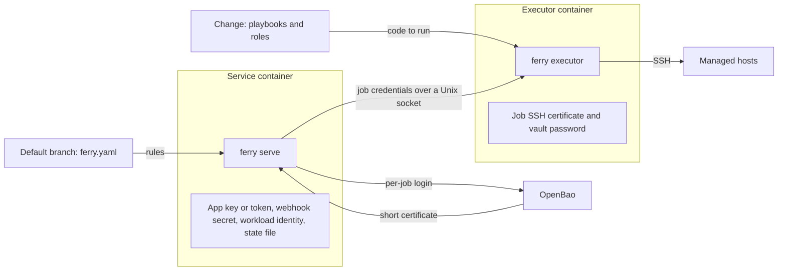

# Security model

This page describes what ferry trusts, what it defends against, and where its limits are. It links
the issue behind each decision, so the reasoning can be checked.

- [What is at stake](#what-is-at-stake)
- [The trust model](#the-trust-model)
- [Trust boundaries](#trust-boundaries)
- [A plan runs the change's code](#a-plan-runs-the-changes-code)
- [Threats and defences](#threats-and-defences)
- [Fail-closed rules](#fail-closed-rules)
- [Secrets handling](#secrets-handling)
- [Known limits](#known-limits)

## What is at stake

ferry holds, or can mint, SSH access to every host in the inventory, usually as root. It also
handles the ansible-vault password. A plan or apply runs code from a pull request with those
credentials. The design goal is that nobody gets that access by a route that skips review.

## The trust model

ferry follows the Atlantis model. The service is trusted, and people with write access to the
config repository are trusted to the extent the review rules allow.

| Actor | Trusted to |
|---|---|
| The service operator | Configure ferry, hold its secrets, flip the switches |
| The default branch | Define the rules: `ferry.yaml` is read from it, never from a change |
| A user with write access | Have their changes planned automatically. Apply a change that someone else approved. |
| A user without write access | Nothing automatic. Their change waits for `/ferry plan` from a writer. |
| An approver | Vouch for one specific head commit, if they have write access and did not contribute to the change |
| An operator with a run identity | Use the inventory credentials they are allowed, directly. See [`ferry run`](run.md). |
| The code host | Report state truthfully, and authenticate webhooks |

Two things are **not** trusted:

- **The contents of a change**, until someone with write access has vouched for that exact commit.
- **Playbook code at run time**, with respect to the service's own secrets. That is what the
  executor is for.

The model has the same consequence as in Atlantis: someone with write access can get code run on
the hosts in check mode without a second person, because their changes are planned automatically.
An apply always needs an approval from someone else (unless `allow_author_approval` is set).

## Trust boundaries

The change's code runs in the executor container. The service's secrets are not mounted there.

## A plan runs the change's code

Check mode limits what tasks do. It does not limit what the controller runs. During a plan, these
execute for real:

- tasks with `check_mode: false`,
- lookups and filters, which run on the controller,
- plugins and modules shipped in the repository,
- `delegate_to: localhost` tasks.

`ferry policy` flags the obvious cases. It is a lint, not a sandbox: a lookup plugin in the
repository gets past it. The real controls are the plan rule (who gets planned automatically) and
the executor (what a running playbook can reach).

**In CI-only mode** neither control exists. Anyone who can push a branch can change
`.gitlab-ci.yml` and `ferry.yaml` on it, so the runner's credential is only as safe as push access.
Use the CI driver for single-owner repositories. For a team, run `ferry serve`.

## Threats and defences

### A change tries to alter its own rules

- `ferry.yaml` is read from the default branch. Only playbooks come from the change.
- Service settings (switches, own-check names, the plan rule) come from the service's environment
  and files, never from the repository.
- Only changes into the default branch, or a branch listed in the default branch's `base_branches`,
  are handled. A change cannot allow its own base, and one retargeted after its plan is refused
  ([#22](https://github.com/jfryman/ferry/issues/22)).

### An unreviewed commit gets applied

- Apply requires the plan record to match the head commit, and the run to be for the head commit.
- **Head-aware approvals.** An approval counts only for the current head. On GitHub that is the
  review's commit. GitLab does not record one, so ferry compares the approval time with the time
  the head arrived, and counts nothing if it cannot tell
  ([#61](https://github.com/jfryman/ferry/issues/61) confirms the behaviour after a rebase).
- Approvals count only from users who could apply themselves, and never from ferry's own account.
  On a public repository, anyone can leave an approving review.
- Approvals from anyone who authored, committed or pushed part of the change do not count
  ([#25](https://github.com/jfryman/ferry/issues/25)).
- **Comments are pinned to the commit they were written about.** `/ferry plan` on someone else's
  change is the vouching step, so it must run what the commenter read, not whatever the head is
  when the worker starts ([#12](https://github.com/jfryman/ferry/issues/12)). Commit dates are not
  used for this, since the author sets them.
- GitHub's own branch protection and rulesets must also allow the merge.

### A stale branch reverts merged work

Ansible applies whole roles. A branch that predates a merged change would put hosts back. Apply
refuses a change that is behind its base ([#23](https://github.com/jfryman/ferry/issues/23)).

### Two changes interleave on the same hosts

The inventory lock is held from plan until merge or close. **Lock checks fail closed**: an API
error while checking the holder keeps the lock instead of giving it away
([#21](https://github.com/jfryman/ferry/issues/21)). Commands on closed or merged changes are
refused, since such a change would never release a lock it took.

### A playbook steals the service's secrets

With the executor, playbooks run as another user in another container that mounts none of the
service's secrets and receives none of its environment. The job's OpenBao token is revoked before
any playbook runs. `ansible-galaxy` runs there too, with a minimal environment
([#26](https://github.com/jfryman/ferry/issues/26)). The executor refuses to start if it can read
a path listed in `FERRY_EXECUTOR_MUST_NOT_READ`, or if it runs as root.

### Forged or replayed webhooks

- Deliveries are authenticated (HMAC on GitHub, secret token on GitLab) before anything else.
- Replays are caught by delivery id **and** by a digest of the body, kept for 7 days across
  restarts, because the delivery id is not signed
  ([#11](https://github.com/jfryman/ferry/issues/11)).
- Comment commands are also deduplicated on the comment id
  ([#37](https://github.com/jfryman/ferry/issues/37)).
- Events older than 10 minutes by their own timestamps are refused, close events included.
- Body size, read timeouts, connection count and queue length are all bounded
  ([#15](https://github.com/jfryman/ferry/issues/15)).

### Forged plan records and comment injection

The plan record must be the last line of a comment by ferry's own account, and under `ferry serve`
it carries an HMAC. Text that comes from the change or from hosts is escaped before it is posted,
and comment size is bounded ([#24](https://github.com/jfryman/ferry/issues/24)).

### Unauthorized users spend credentials

Write access is checked in the webhook handler, before a job exists. All apply gates run before
any credential is minted, so a refused apply costs no OpenBao login and no certificate
([#13](https://github.com/jfryman/ferry/issues/13)).

### An attacker impersonates a host

SSH host keys are checked by default in the image. Without that, anything answering on a host's
address would receive an apply's payload, including vault-decrypted values.

### A writer's account is compromised

The switches stop applies, or automatic plans, at once and without a restart. See
[Operations](operations.md#freeze-applies).

## Fail-closed rules

When ferry cannot determine something, it refuses. This is a rule, and changes must keep it.

| Cannot determine | Result |
|---|---|
| Whether a lock holder is still open (any error except 404 or 410) | The lock is kept and the request refused |
| Whether the change is behind its base | Apply refused |
| Who pushed to the change | No approval counts |
| When an approval was given, on GitLab without `approved_at` and without reset-on-push | No approval counts |
| GitHub's merge state (`unknown`), or GitLab's (`unchecked`, `checking`, `preparing`) | Apply refused |
| A branch protection rule source (missing permission, API error, more than 100 checks) | Apply refused, naming the permission |
| When the commented head arrived | Command refused, suggesting `--sha` |
| An event's timestamp | Event refused |
| The switch directory | Counts as switched off |
| The identity issuer's keys, with nothing cached within the hour | Run refused |
| Whether an old drift run is gone after a restart, without an executor | The drift lock is kept |

## Secrets handling

- Tokens reach git only through `http.extraHeader` in the environment. They are never in a URL, in
  argv or in `.git/config`.
- Per-job credentials live in a 0700 temporary directory that is removed when the job ends.
- Each job has its own SSH ControlPath, so no job reuses another job's authenticated connection.
- The state file holds no tokens or passwords.
- `/healthz`, `/metrics` and `/jobs` return no error text. Metric label values come from fixed
  sets, so no username, branch, commit or URL can appear in them.
- Everything posted to a change passes the [redactor](concepts.md#output-redaction), including the
  error path.
- The identity token command's output and the service's error bodies are never echoed by the CLI.
- An operator's name and subject are never posted to the code host. A change blocked by an operator
  run sees only the run id ([#57](https://github.com/jfryman/ferry/issues/57)).

## Known limits

- **Check mode is not a sandbox.** See above.
- **The playbook can read its own job's credentials.** The SSH key, certificate and vault password
  are needed by the run. Keep certificate TTLs short and principals narrow.
- **A certificate outlives its job.** Revoking the job's token does not revoke the certificate.
- **`ferry run` certificates are not scoped to the locked inventory**, and cannot be revoked. See
  [`ferry run` limits](run.md#limits-you-should-know) and
  [#53](https://github.com/jfryman/ferry/issues/53).
- **`run_allowed` mixes subjects and group names** in one list
  ([#56](https://github.com/jfryman/ferry/issues/56)).
- **GitHub checks are matched by name.** See [Backends](backends.md#branch-protection-and-rulesets).
- **The unauthenticated endpoints rely on network placement.** Keep `/healthz`, `/metrics` and
  `/jobs` off public routes.
- **One instance.** The lock store is a single SQLite file. Losing it frees every lock.
- **No tamper-evident audit trail yet.** `/jobs` keeps the newest `FERRY_JOB_HISTORY` jobs, without
  refusal reasons. Plan details are in the change's comments, the commit statuses and the service
  log. Nothing links an apply to the plan it consumed except the commit. [RFC 0001](rfcs/0001-audit-trail.md)
  proposes a hash-chained audit log and an authenticated API to query it
  ([contract](api/audit.openapi.yaml)). It is a proposal, not implemented.
- **Redaction is pattern-based.** It cannot recognise a transformed secret. Use `no_log`.
