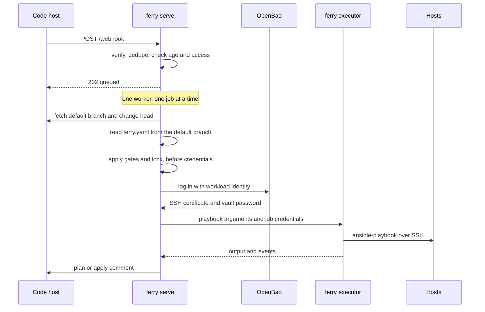

# `ferry serve`

`ferry serve` is the Atlantis-style deployment: one long-running service that receives webhooks,
holds the credentials, and runs plans and applies one job at a time. Nothing in a change can alter
how the service treats it.

- [Request flow](#request-flow)
- [What you deploy](#what-you-deploy)
- [Container image](#container-image)
- [Minimal configuration](#minimal-configuration)
- [The plan rule](#the-plan-rule)
- [Comment commands](#comment-commands)
- [Credentials from OpenBao](#credentials-from-openbao)
- [The executor](#the-executor)
- [Collections](#collections)
- [Webhook intake](#webhook-intake)
- [Commit statuses](#commit-statuses)
- [HTTP endpoints and edge routing](#http-endpoints-and-edge-routing)
- [Deployment examples](#deployment-examples)

For the code host side (GitHub App, GitLab token and webhook) see [Backends](backends.md). For
every setting see the [configuration reference](configuration.md#ferry-serve).

## Request flow



The webhook handler only decides and enqueues, so it answers within the code host's timeout. One
worker thread runs the jobs in order.

## What you deploy

- **One instance** per config repository. Locks live in one SQLite file, as in Atlantis.
- **Persistent storage** for the state file (`FERRY_LOCK_DB`). It holds locks, seen deliveries,
  head arrival times, the job history and operator run leases. Losing it frees every lock.
- **A work directory** (`FERRY_WORKDIR`) for checkouts and caches. It can be ephemeral.
- **The executor** as a second container that shares the work directory and a socket directory with
  the service. Optional, and recommended.
- **OpenBao** for per-job credentials. Optional. Without it, Ansible uses whatever SSH setup the
  container has.
- **A reverse proxy** in front. Only some paths may be public. See
  [edge routing](#http-endpoints-and-edge-routing).
- **`known_hosts`** mounted at `/etc/ssh/ssh_known_hosts` in the container that runs the playbooks.

## Container image

`ghcr.io/jfryman/ferry` is built for linux/amd64 and linux/arm64, with SBOM and provenance
attestations. It contains ferry, ansible-core, git and ssh. Collections are installed at run time.

| Tag | Built from |
|---|---|
| `vX.Y.Z`, `X.Y`, `latest` | Release tags |
| `edge`, `sha-<short>` | Every push to `main` |

Pin a digest in production: `ghcr.io/jfryman/ferry:vX.Y.Z@sha256:...`.

The image is non-root. It has two users: `ferry` (uid 10001) for the service and `ferry-run`
(uid 10002) for the executor. One image runs both commands:

```bash
docker run ... ghcr.io/jfryman/ferry:vX.Y.Z                    # ferry serve (the default command)
docker run -u 10002 ... ghcr.io/jfryman/ferry:vX.Y.Z executor  # ferry executor
```

Image defaults:

| Variable | Default in the image |
|---|---|
| `FERRY_WORKDIR` | `/var/lib/ferry/work` |
| `FERRY_LOCK_DB` | `/var/lib/ferry/state/locks.db` |
| `ANSIBLE_HOST_KEY_CHECKING` | `True` |

The service listens on port 8080 (`FERRY_LISTEN`, default `0.0.0.0:8080`). The image's health check
calls `/healthz`.

**Host keys are checked.** Without that, anything answering on a host's address would receive an
apply's payload, including values decrypted with the vault password. Mount a `known_hosts` file
with pinned keys, or with `@cert-authority` lines if your hosts have signed host certificates.

## Minimal configuration

GitHub:

```bash
FERRY_GITHUB_REPO=example-org/ansible
FERRY_GITHUB_APP_ID=123456
FERRY_GITHUB_APP_KEY_FILE=/run/secrets/app.pem
FERRY_WEBHOOK_SECRET_FILE=/run/secrets/webhook-secret
FERRY_LOCK_DB=/var/lib/ferry/state/locks.db
FERRY_SSH_USER=root
```

GitLab:

```bash
FERRY_GITLAB_URL=https://gitlab.example.com
FERRY_GITLAB_PROJECT=example-group/ansible
FERRY_GITLAB_TOKEN_FILE=/run/secrets/gitlab-token
FERRY_WEBHOOK_SECRET_FILE=/run/secrets/webhook-secret
FERRY_LOCK_DB=/var/lib/ferry/state/locks.db
FERRY_SSH_USER=root
```

At startup the service reads its identity from the code host, so a wrong credential fails fast. If
the code host is unreachable or answers 5xx, it retries with backoff (`FERRY_STARTUP_ATTEMPTS`,
default 8). A 4xx exits at once.

## The plan rule

A plan runs the change's playbooks with real SSH access. Check mode limits what tasks do, but
`check_mode: false` tasks, lookups and plugins run for real. So ferry plans automatically only when
it trusts whoever wrote the code:

- The author has write access (Developer or higher on GitLab).
- For a push into an existing change, the pusher has write access too.

Anyone else's change, or push, gets one note and waits for `/ferry plan` from someone with write
access. That comment vouches for the code the commenter read.

Draft changes and changes from forks are not planned automatically.

## Comment commands

A comment whose first line starts with `/ferry` is a command. All other comments are ignored and
never answered.

| Command | Does | Needs |
|---|---|---|
| `/ferry plan [inventory] [--sha COMMIT]` | Plan the change | Write access |
| `/ferry apply [inventory] [--sha COMMIT]` | Apply, if every [apply gate](concepts.md#apply-gates) passes | Write access |
| `/ferry unlock [inventory]` | Release this change's lock (all of its locks without an inventory) | Write access |
| `/ferry help` | List the commands | Nothing |

The inventory can also be written `-i NAME` or `--inventory NAME`. Commands run only on open
changes.

**A command runs the commit it was written about.** `/ferry plan` and `/ferry apply` are pinned to
the head as of the comment's creation time. ferry knows when each head arrived from the signed
webhook events it received. It refuses, with a note:

- a head that arrived after the comment,
- a head ferry never saw arrive (a change older than the service).

`--sha <commit>` names the commit outright (7 to 40 hex characters, matched as a prefix of the
head). If the head moves while the job is queued, the job does not run and says so.

**Mistyped commands.** A comment that starts with `/ferry` but does not parse (`/ferry aply`) gets
the help text with what ferry did not understand. Help replies are limited to one per change per
10 minutes.

**Access is checked before a job exists.** A command from someone without write access is refused
in the webhook handler. It costs one API call and no credential.

## Credentials from OpenBao

Set `FERRY_OPENBAO_ADDR` and `FERRY_OPENBAO_JWT_FILE` to give each job its own credentials:

1. The service logs in to OpenBao with its workload identity token (a JWT from Nomad, Kubernetes or
   another issuer).
2. It generates a throwaway ed25519 key and has OpenBao's SSH CA sign it.
3. It reads the ansible-vault password, if `FERRY_OPENBAO_VAULT_PASSWORD_PATH` is set.
4. It revokes its OpenBao token. This happens before any playbook runs.
5. When the job ends, the credential directory is removed.

Each job also gets its own SSH ControlPath, so no job reuses another job's connection.

Things to set deliberately:

- `FERRY_OPENBAO_SSH_TTL`: the certificate lifetime. A certificate outlives its job, because
  revoking the token does not revoke the certificate. Keep it short.
- `FERRY_OPENBAO_SSH_PRINCIPAL`: the principal to request. Keep it narrow.
- `FERRY_JOB_TIMEOUT_MINUTES`: kills a run after this long. Keep it below the certificate TTL, or
  a long apply fails on new connections halfway.
- `FERRY_OPENBAO_PLAYBOOK_TOKEN=1`: keeps the token alive and passes it to playbooks as
  `VAULT_TOKEN`, for `community.hashi_vault` lookups. That token can sign more certificates until
  it expires. Off by default.

**Kubernetes.** OpenBao's `kubernetes` and `jwt` auth methods take the same login body. Set
`FERRY_OPENBAO_AUTH_MOUNT=kubernetes` and point `FERRY_OPENBAO_JWT_FILE` at the service account
token.

The apply gates run before any credential is minted, so a refused apply costs no OpenBao login and
no certificate.

## The executor

A plan runs the change's own playbooks, and a playbook can run code on the controller: lookups,
`delegate_to: localhost`, `check_mode: false` tasks, plugins in the repository. Inside the service
process, that code could read the App key or GitLab token, the webhook secret, the workload
identity token and the state file.

With `FERRY_EXECUTOR_SOCKET` set, `ferry serve` does not run Ansible itself. `ferry executor` does,
as another user in its own container that mounts none of those secrets.

Set up:

- Run the same image with the command `executor`, as uid 10002.
- Share two directories with the service: the work directory (read-only for the executor) and the
  socket's directory.
- Set `FERRY_EXECUTOR_SOCKET` to the same path in both containers.
- Set `FERRY_EXECUTOR_MUST_NOT_READ` in the executor to a colon-separated list of the service's
  secret paths. The executor refuses to start if it can read any of them, or if it runs as root.
- Mount `known_hosts` in the executor.

How it works:

- Per job, the service sends the `ansible-playbook` arguments, the job's own environment (never the
  service's) and the contents of the job's credential files. The executor writes them into a
  private per-job directory, runs the play, streams the output back and deletes the directory.
- As its container's PID 1, the executor kills every other process in the container after each
  job. It also binds its socket again if a playbook replaced it. Nothing a playbook leaves behind
  sees the next job's credentials.
- The playbook can still read the job's own SSH key, certificate and vault password. It needs
  them. This is inherent.

Why a second container and not a second user in the same one: switching users needs root or
`CAP_SETUID` in the service's container, and the secret files would still sit on the same
filesystem. A second container needs no privileges, and the secrets are not there at all. A pod or
job per run would also work, but the service would then need the right to create pods or submit
jobs, which is a bigger grant than the one it protects.

In the [local lab](../deploy/local/README.md), `lab.sh evil` and `lab.sh leakcheck` run a hostile
plan and show what it could read.

## Collections

If the change has a `requirements.yml`, ferry runs `ansible-galaxy collection install` before the
play:

- In the executor when there is one, into its own cache (`FERRY_EXECUTOR_COLLECTIONS`). Otherwise
  in the service.
- With a minimal environment: no `FERRY_*` variables, no tokens, a throwaway `HOME`.
- With a hard timeout (`FERRY_GALAXY_TIMEOUT_SECONDS`, default 300).

`FERRY_GALAXY=skip` never reads `requirements.yml`, for images that ship their collections.
`FERRY_GALAXY_SERVER` pins the Galaxy server and refuses requirements that name URLs, git, files
or another `source:`. Cache entries unused for `FERRY_COLLECTIONS_MAX_AGE_DAYS` (14) are pruned.
Git fetches have their own timeout (`FERRY_GIT_TIMEOUT_SECONDS`, default 300).

## Webhook intake

**Authentication.** GitHub deliveries are verified by HMAC signature. GitLab deliveries carry the
secret token in a header, compared in constant time.

**Replays.** A delivery is a duplicate if its id or its exact body was seen before. The delivery id
is not covered by GitHub's signature, so the id alone cannot identify a replay. Seen deliveries are
kept in the state file for 7 days, across restarts. Comment commands are also deduplicated on the
comment or note id, so a comment re-encoded under a fresh delivery id still runs at most once.

**Stale events.** Events whose own timestamps are older than `FERRY_WEBHOOK_MAX_AGE_MINUTES` (10)
are refused, close events included. A replayed close would otherwise free a reopened change's
locks. Timestamps more than 5 minutes in the future, and events with no readable timestamp, are
refused too. The cost: a manual redelivery more than 10 minutes late is refused. Comment again
instead.

**Limits.**

| Limit | Value |
|---|---|
| Request body | `FERRY_MAX_BODY_BYTES`, default 1 MiB. Larger bodies get 413. Chunked bodies get 411. |
| Socket read and write timeout | 15 seconds |
| Concurrent connections | 32 |
| Queued jobs | 50. Beyond that, webhooks get 503 and the delivery can be retried. |

Refused deliveries are counted in `ferry_webhook_rejected_total` by reason. See
[Operations](operations.md#metrics).

## Commit statuses

With `FERRY_COMMIT_STATUS=1`, ferry posts commit statuses on the change's head, one pair per
inventory:

| Status | pending | success | failure |
|---|---|---|---|
| `ferry/plan: <inventory>` | Planning | The plan is clean, or no host is affected | Not clean, or refused |
| `ferry/apply: <inventory>` | Planned and not applied yet, or applying | Applied, or nothing to apply | The apply had failures |

A new push has no statuses until ferry plans it. So a required `ferry/apply: <inventory>` blocks
the merge until that exact head is applied.

- **GitHub:** add the status to the branch's required status checks (ruleset or branch
  protection), and give the App **Commit statuses: write**.
- **GitLab:** with "Pipelines must succeed", the pending `ferry/apply` status holds the merge until
  the apply succeeds. ferry's Developer token is enough.

ferry's own statuses never block ferry's own apply. On GitHub, checks and statuses posted by
ferry's App are ignored by the merge-rule gate. On GitLab, a "pipeline must succeed" blocker is
ignored when every status that is not green is a `ferry/` status posted by ferry's own account. A
status with ferry's name from anyone else counts like any other.

Without the permission, ferry logs once and carries on without statuses until it is restarted.

## HTTP endpoints and edge routing

The service has one listener. All paths are on the same port.

| Path | Method | Authentication | Purpose |
|---|---|---|---|
| `/webhook` | POST | Webhook signature or secret token | Code host events |
| `/api/runs` | POST | Identity JWT | Start an [operator run](run.md). Answers 404 unless the run API is enabled. |
| `/api/runs/{id}/lease` | POST | Identity JWT | Renew a run's lease |
| `/api/runs/{id}/finish` | POST | Identity JWT | Finish a run |
| `/healthz` | GET | None | Queue depth, the last job, and the switches |
| `/metrics` | GET | None | Prometheus metrics |
| `/jobs` | GET | None | Job history, `?limit=N` (default 50, at most 200) |

**`/healthz`, `/metrics` and `/jobs` are unauthenticated.** They contain no secrets and no error
text, but they are internal. Never route them publicly. Scrape them from inside the private
network.

`/jobs` is a summary, not an audit trail. [RFC 0001](rfcs/0001-audit-trail.md) proposes an
authenticated audit API under `/api/v1` that would replace it, with this
[OpenAPI contract](api/audit.openapi.yaml). Neither is implemented yet.

At the public edge, allow only:

- `POST /webhook`, restricted to the code host's source addresses where you can, and
- `POST /api/runs` and `POST /api/runs/{id}/lease|finish`, if operators reach the service that way.

Deny every other path and method. Do not expose the backend port directly. The service has no
second listener, so the split has to be enforced in your ingress or reverse proxy. The Nomad
example has an explicit path allowlist.

## Deployment examples

- **Nomad:** [`deploy/nomad/ferry.nomad.hcl`](../deploy/nomad/ferry.nomad.hcl) is a starting point:
  the service and the executor as two tasks in one group, sharing the allocation directory.
- **Kubernetes:** run the executor as a second container in the same pod, with the work directory
  and the socket directory as shared volumes. The repository has no manifest for this yet.
- **Local lab:** [`deploy/local/`](../deploy/local/README.md) runs the whole setup in containers on
  one machine.
