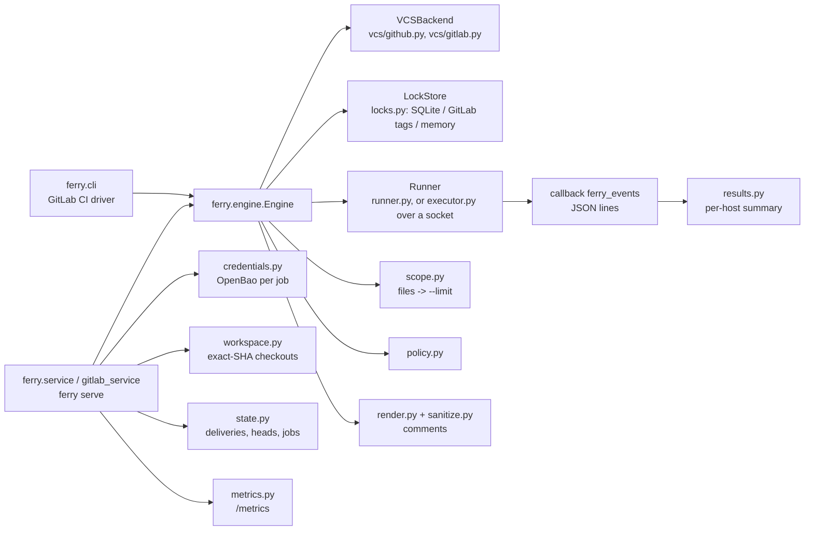

# ferry: summary

Atlantis-style plan/apply/drift for Ansible. The engine is independent of any one driver: it runs
from GitLab CI (`ferry plan|apply|drift|unlock`), or as a long-lived webhook service
(`ferry serve`) for a GitHub App or a GitLab project.

## State (0.3.0 + unreleased operator runs)

- `ferry run`: operator Ansible is local; the service verifies OpenBao RS256 identity JWTs,
  authorizes global + default-branch inventory allowlists, owns renewable SQLite leases and
  signing, records the certificate serial. See [operator-runs.md](operator-runs.md).
- Engine, policy, scope (`--limit` from changed files), per-host results, drift textfile metrics.
- Drivers: GitLab CI (CLI, tag locks) and `ferry serve` (GitHub App or GitLab; SQLite locks in the
  service's state file; per-job OpenBao credentials: workload-identity login, throwaway SSH
  certificate, vault password).
- `ferry executor`: playbooks run as another user/container that can't read the service's secrets.
- Service state file (`FERRY_LOCK_DB`, SQLite) holds locks, seen deliveries (id + body digest, 7 days),
  when each PR head arrived (pins comments to the head they were about), and the job history.
- Intake hardening: stale-event window, replay dedupe, a 1 MiB body cap and socket timeouts. Apply
  gates run before credentials.
- Observability: `/metrics` (Prometheus, fixed label sets), `/jobs` (bounded history), `/healthz`.
- Distribution: wheel on tags (GitLab CI, project PyPI registry); container image
  `ghcr.io/jfryman/ferry` (GitHub Actions, linux/amd64 + linux/arm64). The service and the executor
  are the same image with a different command. See practices.md for the release steps.

## Shape

See [decisions.md](decisions.md) for why it's built this way, README for user-facing behavior.
