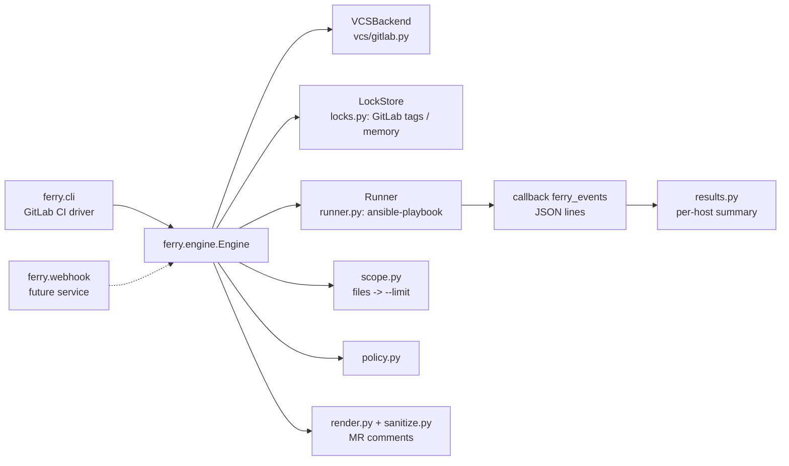

# ferry: summary

Atlantis-style plan/apply/drift executor for Ansible. Built 2026-11-14 by Pip for James: first
consumer is `infra/ansible` (Raspberry Pis that can't run Puppet); James also wants it reusable at
his day job, so the engine is kept independent of GitLab CI.

## State (2026-11-14)

- v0.1.1 (0.1.0 + diff header fix): engine, GitLab backend, tag locks, CLI, webhook core (parse + trigger), drift metrics.
- Driver in use: GitLab CI in infra/ansible (`ferry plan` on MR, manual `ferry:apply`,
  scheduled `ferry drift`, `ferry unlock` on main).
- Not deployed: the webhook service (comment-triggered `/ferry apply`). Code + tests exist.
- No real hosts yet: the Pi inventory is pending (SSH bootstrap with James).

## Shape

See [decisions.md](decisions.md) for why it's built this way, README for user-facing behavior.
